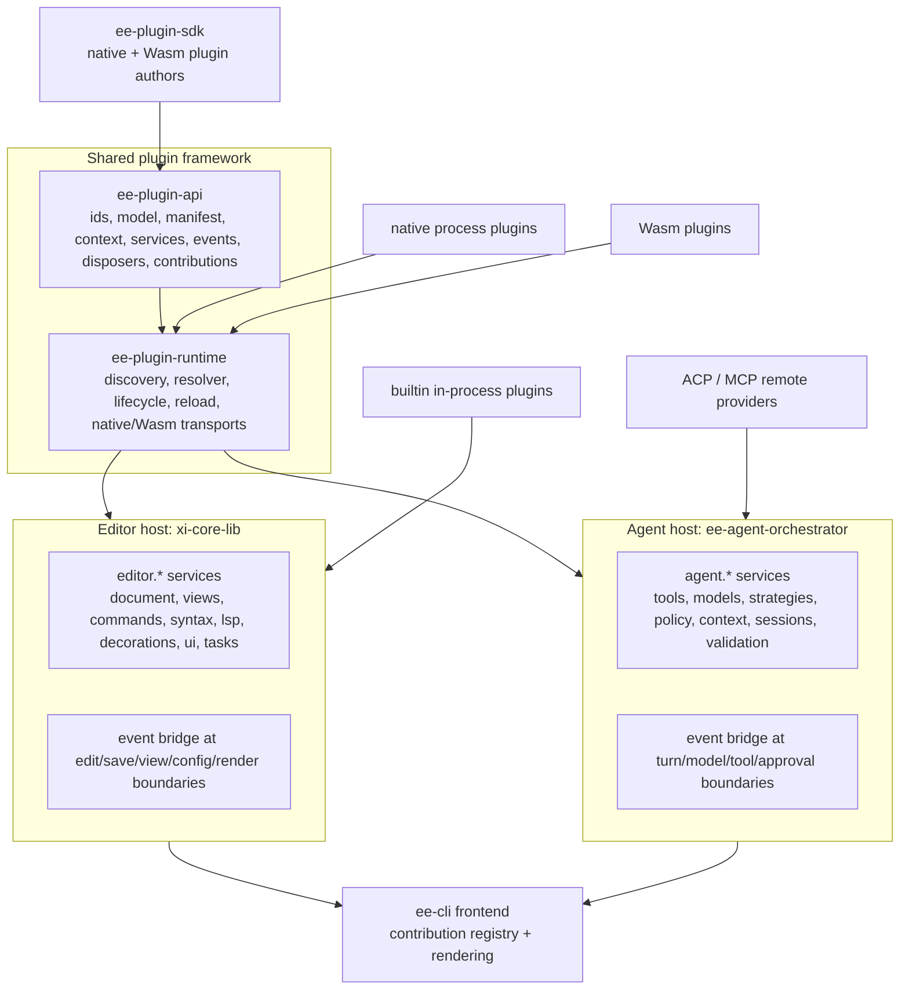

# Cordis-Style Plugin System — Design + Plan

Status: **design, pending review** · Scope: editor backend (`xi-core-lib`), plugin SDK (`xi-plugin-lib` → new SDK), terminal frontend (`ee-cli`), agent runtime (`ee-agent-orchestrator`), provider crates, and the ACP/MCP host boundary.

## 1. Goal

Move `ee` to one Cordis-style plugin system. The new release only runs the new system. There is no manifest v1 path, no legacy plugin trait, no compatibility RPC, and no adapter layer.

Acceptance shape:

- A plugin can add a **feature**: command, language service, formatter, agent tool, model adapter, context provider, validation provider.
- A plugin can **modify the interface** through declarative contributions: status items, panels, overlays, pickers, decorations, keybindings, command palette entries, ex-command aliases.
- A plugin can **intercept or improve behavior** through typed events (`emit`, `waterfall`, `parallel`, `serial`, `bail`).
- The same plugin contracts work for the **editor host** and the **agent host**.
- The frontend is a renderer/client, not a plugin host; there is no second plugin ingestion point in the UI.
- Core editor truth stays unchanged: rope/document model, edit semantics, undo/redo, selection truth, revisions, VLF behavior, file consistency, and protocol ownership.
- Old plugin crates, manifests, RPC types, and lifecycle code are deleted from the release tree.

Non-goals:

- No plugin-defined renderer or arbitrary terminal drawing.
- No plugin-owned buffer mutation semantics, undo model, or VLF behavior.
- No arbitrary code evaluation in plugin config (no Cordis `!!js` equivalent; safe interpolation only).
- No plugin-defined tree-sitter runtime. Grammars, queries, and parser loading stay backend infrastructure.
- No in-process plugin code in the terminal frontend. Frontend only renders declarative contributions.

## 2. Current State (verified)

| Area | Today | Limitation |
|---|---|---|
| Plugin SDK | `crates/xi-plugin-lib/src/lib.rs` `Plugin` trait: `initialize`, `update`, `did_save`, `did_close`, `new_view`, `config_changed`, `language_changed`, `custom_command`, `idle`, `shutdown`, `get_hover` | Fixed callback set; update-centric; no service registry, dependency injection, effect scoping, or generic event surface. |
| Derive macro | `crates/xi-plugin-derive/src/lib.rs` `#[xi_plugin]` | Generates the old `Plugin` impl; must be replaced with the new SDK macro. |
| Host → plugin RPC | `crates/xi-core-lib/src/plugins/rpc.rs` `HostNotification` / `HostRequest` | Closed enums. Adding a capability requires editing core enums, SDK dispatch, Wasm ABI, and frontend parsing. |
| Plugin → host RPC | `PluginRequest` / `PluginNotification` in the same file | Fixed operations: edit, get data, selections, diagnostics, hover, completions, code actions, locations, symbols, annotations, status items. Formatting and code actions are still `501` in `do_plugin_cmd_sync`. |
| Capabilities | `crates/xi-core-lib/src/plugins/manifest.rs` `PluginCapability`: `Edit`, `Hover`, `Annotations`, `StatusItems`, `Filesystem`, `Network` | Coarse; no scoped permissions, service requirements, or per-contribution gates. `Edit` is reused for every LSP command in `crates/xi-core-lib/src/edit_types.rs`. |
| Manifest | `manifest_version = 1`; `requires` is a list of plugin name/version strings; activation is `Autorun` / `OnSyntax` / `OnCommand` | No service dependencies, contribution model, config schema, target host, trust tier, limits, or overlays. |
| Lifecycle | `crates/xi-core-lib/src/tabs/plugins.rs`, `tabs/plugin_lifecycle.rs`, `tabs/plugin_events.rs`; catalog loaded once in `CoreState::finish_setup` (`tabs/construction.rs`) | Language/startup activation only; no plugin-set reload with rollback; lifecycle is intertwined with core state. |
| Command routing | `event_context/plugins.rs::dispatch_capability_command`; `event_context/dispatch.rs::dispatch_command_to_plugins` | Matches `has_capability` + method string. New commands require core changes. |
| Frontend consumption | `crates/ee-cli/src/backend.rs::parse_notification` handles `hover`, `completions`, `locations`, `symbols`, `diagnostics`, `code_actions`, but not `add_status_item` / `update_status_item` / `remove_status_item` | Status items from plugins and LSP are sent by core and silently dropped by `ee-cli`. UI surface is fixed and mostly not generic. |
| Command palette / keymap | `ee-cli/src/app/commands`, `ee-cli/src/keymap/*` | Static action list. No plugin command registration, dynamic palette rows, or contributed keybindings. |
| LSP | `crates/xi-lsp-lib` native process plugin (`manifest.toml`, `src/bin/xi-lsp-plugin.rs`, `lsp_plugin/plugin_impl.rs`) | Implements the old `Plugin` trait, uses `CoreProxy`, and depends on hardcoded core command names. |
| Agent | `crates/ee-agent-orchestrator/src/tools.rs` `ToolRegistry` / `ServerTool`; `ModelAdapter`; policy, strategy, context planner are compile-time code | No plugin registration for tools/models/policies/strategies; ACP and MCP are separate adapters, not a common plugin surface. |
| Config | `[lsp.*]`, `[agents.*]`, `[mcp.*]`, free-form `ConfigDomain::PluginConfig` | No manifest-declared plugin config schema, no per-plugin enable/disable overlay, no workspace plugin trust gate. |
| Packaging | `scripts/install-plugins.sh`, `release.yml`, `fuzz.yml`, test helpers install `xi-lsp-plugin` from `manifest.toml` | All assume manifest v1 and old binary/manifest layout. |
| Shared semantic types | `Range`, `Diagnostic`, `SelectionRange`, `Hover`, `TextEdit`, `SymbolItem`, `NavigationTarget`, `CompletionSuggestion`, `CodeAction` live in `xi_core_lib::plugin_rpc` and are used by `ee-cli` tests | Plugin-specific namespace is used as the editor type namespace. Move to neutral model types before deleting `plugin_rpc`. |

## 3. Cordis Mapping

| Cordis idea | ee implementation |
|---|---|
| A plugin is an object implementing `Service` or a function with `apply(ctx)` | `Plugin` trait with `apply(&PluginContext)`; builtin, native process, and Wasm adapters implement the same trait. |
| A context is a repository of services | `PluginContext` owns a `ServiceRegistry`, an `EventBus`, a `DisposerStack`, scoped config, and a host scope. Child contexts inherit parent services. |
| Service claims `ctx.<key>` | Stable `ServiceId` string (`editor.document@1`) plus `ServiceKey<T>` for typed lookup. |
| `inject` declares required services | Manifest `requires.services` plus `Plugin::requires()`; loader activates only when providers exist. |
| Typed events with dispatch modes | `EventBus` (sync) and `AsyncEventBus` (agent) with `emit`, `waterfall`, `parallel`, `serial`, `bail`. |
| Registrations are reversible effects | `ctx.effect(...)` and `ctx.on(...)` return `Disposer`; each plugin scope unwinds LIFO on unload/reload. |
| Loader config with overlays | Manifest v2 + host/workspace/plugin config layers; no code evaluation. |
| Encapsulate behavior into plugins | `editor.*` and `agent.*` service namespaces; LSP, tools, models, UI contributions become plugins. |

Cordis calls services directly from plugin code. ee needs one additional rule because core state is shared behind `Arc<Mutex<CoreState>>` / `RefCell`:

> A plugin callback must never run while the core holds a mutable borrow, and must never synchronously re-enter the event that invoked it. Mutations are returned as `Effect` values and applied by the host after the callback returns. Read-only services may return immutable snapshots or queued query handles.

This keeps the Cordis service model without risking deadlocks or revision races.

## 4. Target Architecture



### 4.1 New crates and modules

File-size rule: each new module stays well below 1,000 LOC; no new logic is added directly to the large existing files (`event_context/dispatch.rs`, `plugins/mod.rs`, `tools.rs`, `loop_engine.rs`, etc.).

```text
crates/ee-plugin-api/src/
  lib.rs
  ids.rs              ServiceId, CommandId, PluginInstanceId, ScopeId
  model.rs            neutral editor model types: Range, SelectionRange,
                      Diagnostic, Hover, TextEdit, SymbolItem, NavigationTarget,
                      CompletionSuggestion, CodeAction, PluginBufferInfo, PluginUpdate
  manifest.rs         manifest v2 model + schema
  context.rs          PluginContext, child scopes
  service.rs          Service trait, ServiceKey<T>, ServiceRegistry
  event.rs            Event trait, modes, sync + async buses
  disposer.rs         Disposer, DisposerStack
  contribution.rs     commands, ui, decorations, tools, models, config
  effect.rs           host-applied effects
  wire.rs             new host ↔ plugin wire types (no old enum names)
  error.rs            PluginError, diagnostic classes
  host.rs             HostKind, HostContext, HostAdapter trait

crates/ee-plugin-runtime/src/
  lib.rs
  discovery.rs        plugin directories, manifests, origin hashes
  resolver.rs         service/plugin dependency graph, cycles, ordering
  manager.rs          activate/deactivate/reload/rollback/crash policy
  activation.rs       startup/language/command/event/workspace rules
  config.rs           layered plugin config, safe interpolation
  native.rs           native process supervisor adapter
  wasm.rs             wasmtime adapter + capability imports
  health.rs           resource limits, crash counters, diagnostics
  diagnostics.rs      stable load/activation/health reports
```

`ee-plugin-sdk` replaces `xi-plugin-lib`. `ee-plugin-derive` replaces `xi-plugin-derive`. `xi-plugin-lib` and `xi-plugin-derive` are removed from the workspace.

Workspace wiring:

- add members `crates/ee-plugin-api`, `crates/ee-plugin-runtime`, `crates/ee-plugin-sdk`, `crates/ee-plugin-derive`
- add workspace dependencies for the four new crates
- remove members/dependencies `crates/xi-plugin-lib`, `crates/xi-plugin-derive`
- move `wasmtime`, `seccomp`, and `windows-sys` ownership from `xi-core-lib` to `ee-plugin-runtime`
- add `ee-plugin-runtime` to `ee-cli` for plugin diagnostics/management, not for rendering

### 4.2 Editor host modules

```text
crates/xi-core-lib/src/plugin_runtime/
  mod.rs
  host.rs             EditorPluginHost
  services/mod.rs
  services/document.rs
  services/views.rs
  services/commands.rs
  services/syntax.rs
  services/lsp.rs
  services/decorations.rs
  services/ui.rs
  services/fs.rs
  services/tasks.rs
  events.rs
  effects.rs
  bridge.rs           hooks called from EventContext / CoreState
```

### 4.3 Agent host modules

```text
crates/ee-agent-orchestrator/src/plugin_runtime/
  mod.rs
  host.rs             AgentPluginHost
  services/mod.rs
  services/tools.rs
  services/models.rs
  services/strategies.rs
  services/policy.rs
  services/context.rs
  services/sessions.rs
  services/validation.rs
  events.rs
  effects.rs
  bridge.rs
```

### 4.4 Frontend modules

```text
crates/ee-cli/src/plugin_ui/
  mod.rs
  contributions.rs    wire parsing + validation
  registry.rs         commands, status, panel, overlay, picker, palette registries
  render.rs           ratatui rendering for declarative contributions
  keybindings.rs      merge plugin defaults with user keymap
  ex_commands.rs      contributed ex-command aliases
  sanitize.rs         text/bounds/ANSI/control-sequence safety
```

### 4.5 Frontend is not a plugin host

There is no second plugin ingestion point in the terminal frontend. The split is:

| Layer | Role |
|---|---|
| Editor backend (`xi-core-lib`) | Discovers, validates, loads, sandboxes, and disposes **editor plugins**. Owns services, events, permissions, and effects. |
| Agent backend (`ee-agent-orchestrator`) | Discovers, validates, loads, and disposes **agent plugins**. Owns agent services, model/tool policy, and session scopes. |
| Frontend (`ee-cli`, future GUI/web) | Consumes contribution snapshots, renders supported contribution kinds, captures input, and sends `command` / `ui_event` intents back to the backend. |

Consequences:

- No plugin manifest, executable, Wasm module, or plugin config is read by the frontend.
- No plugin code runs in the frontend process. The frontend has no plugin sandbox or permission model.
- Every frontend sees the same backend contributions; frontend-specific extras are selected through frontend capability negotiation, not through a separate plugin install tree.
- Adding a new frontend means implementing the contribution renderer and `command`/`ui_event` client, not writing a second plugin loader.
- If a future requirement needs frontend-native extension code, that is a separate third host with the same `ee-plugin-api` contracts. It is not part of this plan.

## 5. Core Abstractions

### 5.1 Services

```rust
pub struct ServiceId(&'static str);

pub struct ServiceKey<T: ?Sized> {
    id: ServiceId,
    _marker: PhantomData<fn() -> T>,
}

pub trait Service: Send + Sync + 'static {
    const ID: &'static str;
}

pub struct ServiceRegistry {
    // Keyed by ServiceId for manifest/diagnostic visibility.
    // Value is Arc<dyn Any + Send + Sync>; lookup checks TypeId before
    // downcast so a wrong typed handle fails closed.
    services: HashMap<ServiceId, Arc<dyn Any + Send + Sync>>,
}
```

Rules:

- One provider per `ServiceId`. Duplicate registration is an error; replacement requires host policy (`allow_replace`) and a diagnostic.
- Service IDs are stable and versioned: `editor.document@1`, `agent.tools@1`.
- `ServiceKey<T>` provides compile-time typing; `ServiceId` provides manifest-visible dependency names.
- Builtin services register before plugin activation. Plugin-provided services register during `apply`; dependents activate afterward.
- A service declaration option `optional = true` allows activation with a degraded context; missing required services fail that plugin only.

### 5.2 Plugin and context

```rust
pub trait Plugin: Send + Sync + 'static {
    fn name(&self) -> &str;
    fn requires(&self) -> &'static [ServiceId] { &[] }
    fn apply(&self, ctx: &PluginContext) -> Result<(), PluginError>;
}

impl PluginContext {
    pub fn service<T: Service>(&self) -> Option<Arc<T>>;
    pub fn require<T: Service>(&self) -> Result<Arc<T>, PluginError>;

    pub fn on<E: Event>(&self, listener: impl Fn(&E) + Send + Sync + 'static) -> Disposer;

    pub fn effect<F, D>(&self, install: F) -> Result<(), PluginError>
    where
        F: FnOnce() -> Result<D, PluginError>,
        D: FnOnce() + Send + 'static;

    pub fn command(
        &self,
        spec: CommandSpec,
        handler: Arc<dyn CommandHandler>,
    ) -> Result<Disposer, PluginError>;

    pub fn contribute(&self, contribution: Contribution) -> Result<Disposer, PluginError>;
}
```

`apply` runs outside the core lock. A plugin may register listeners, commands, services, and contributions. It must not hold a core borrow.

### 5.3 Effects for mutation

Command handlers and event listeners return effects; the host applies them on the core thread in a deterministic order.

```rust
pub enum Effect {
    ApplyEdit(EditRequest),          // revision-checked, undo-group aware
    SetSelection(SelectionRequest),  // view-owned selection truth
    ScrollTo(ScrollRequest),
    SetStatus(StatusItem),
    RemoveStatus(StatusItemKey),
    SetDecorations(DecorationPatch),
    ShowPanel(PanelUpdate),
    ShowOverlay(OverlayUpdate),
    ShowPicker(PickerUpdate),
    RunTask(TaskRequest),
    EmitAgentToolResult(AgentToolResult),
    Noop,
}

pub trait CommandHandler: Send + Sync + 'static {
    fn invoke(&self, request: CommandRequest) -> Result<Vec<Effect>, PluginError>;
}
```

For agent tools, `ServerTool` returns a `ToolResult`; the host keeps the existing executor pipeline and only replaces the registry backing store with the `agent.tools` service.

### 5.4 Sync and async event buses

The editor hot path is synchronous and must never block. The agent is asynchronous (`tokio`). Use two buses with the same registration/disposer semantics.

| Mode | Editor bus | Agent bus | Semantics |
|---|---|---|---|
| `emit` | synchronous | async | Observe, no return. Listener order = registration order. |
| `waterfall` | synchronous | async | Wraps/delegates; `next()` controls continuation; short-circuit by returning. |
| `parallel` | not used on hot path | async | All listeners run concurrently; no return. |
| `serial` | synchronous | async | Listeners run in order; returns last value. |
| `bail` | synchronous | async | First non-`Continue` value stops dispatch and wins. |

Event identity:

- In-process events use a typed `Event` trait plus `TypeId` for dispatch.
- Every event carries a stable `const NAME` used by the manifest, external wire protocol, diagnostics, and tests. Renaming a wire event is a breaking plugin API change.
- External plugins subscribe to the same names listed in §7; host-side listeners use the typed Rust event.

Listener budgets:

- Editor listeners must be non-blocking and bounded; slow work is queued through `editor.tasks`.
- Listener panics are caught at the plugin scope boundary, reported as diagnostics, and do not unwind core.
- Dispatch depth and listener count are capped; a plugin cannot register unbounded listeners.
- `document.changed` is emitted per committed delta but coalesced for external process plugins, preserving current backpressure.

### 5.5 External and Wasm plugin bridge

Native process plugins keep a JSON-RPC transport (`stdio_newline` or `stdio_content_length`), but the method namespace is new. There are no old `HostNotification` / `PluginRequest` variants.

| Direction | Method | Payload |
|---|---|---|
| host → plugin | `plugin/initialize` | plugin id, host kind, API version, services, config, limits |
| host → plugin | `plugin/event` | event name, revision, bounded payload |
| host → plugin | `plugin/command` | command id, request id, args, deadline |
| host → plugin | `plugin/contribution/request` | request a fresh contribution snapshot |
| host → plugin | `plugin/shutdown` | reason |
| host → plugin | `plugin/response` | response to `plugin/request` (result or typed error) |
| plugin → host | `plugin/request` | service id, method, params, request id |
| plugin → host | `plugin/effect` | effect list for a command or event |
| plugin → host | `plugin/contribution` | contribution upsert/remove |
| plugin → host | `plugin/health` | degraded/recovered state, bounded reason |
| plugin → host | `plugin/response` | request id, result or typed error |

The initialize handshake is acknowledged by a `plugin/response` with request id
`0`. This keeps startup deterministic: the host waits for the ack (bounded by
the manifest RPC timeout) before activating dependents.

The SDK hides this wire protocol behind typed service clients:

- `DocumentClient`, `ViewsClient`, `CommandsClient`, `SyntaxClient`, `LspClient`, `UiClient`, `TasksClient` for editor plugins.
- `ToolsClient`, `ModelsClient`, `PolicyClient`, `ContextClient`, `SessionsClient` for agent plugins.
- `DocumentCache` / `ViewState` helpers cache snapshots and apply `document.changed` deltas without exposing raw transport.
- `ee-plugin-derive` `#[plugin]` generates the `Plugin::apply` entry point and optional command/event method routing.

Wasm plugins use the same logical methods through host imports/exports:

- imports: `host_event`, `host_command`, `host_service_call`, `host_contribute`, `host_health`
- exports: `plugin_alloc`, `plugin_dealloc`, `plugin_apply`, `plugin_event`, `plugin_command`, `plugin_contribution`
- host enforces the same permissions, timeouts, memory caps, and contribution limits as native plugins.

All external calls carry a deadline and cancellation token. A plugin that does not answer within its deadline is reported and its scope is disposed.

## 6. Service Catalog

Feature classification:

| Feature | Owner | Plugin path |
|---|---|---|
| Rope/document model, edit ops, undo/redo, selection truth, revisions, VLF, file consistency | Core, non-plugin | Read/edit services only; no implementation replacement |
| Tree-sitter grammar/query runtime | Core infrastructure | Read-only `editor.syntax` service |
| Syntax scopes, folds, symbols | Core service | Plugins query; language plugins may contribute definitions |
| LSP, formatters, code actions | Plugin | `editor.lsp`, `editor.commands` |
| UI layout, modes, input, rendering | Frontend | Declarative contributions only |
| Search | Core builtin now | Optional `editor.search` provider later; not required for v2 cutover |
| VCS/git | Frontend/core builtin now | Optional `editor.vcs` provider later; not required for v2 cutover |
| Agent tools, models, strategies, policy, context, validation | Builtin plugin providers | `agent.*` services |

Non-plugin core stays non-plugin. Everything else is expected to register through a service or contribution; no new hardcoded plugin-specific branch should be added to core after the cutover.

### 6.1 Editor host (`editor.*`)

| Service | Kind | Operations | Default permission | Notes |
|---|---|---|---|---|
| `editor.document` | read | snapshot, rev, len, line count, line/range text, document text within cap | `editor.document.read` | Immutable snapshots; no core borrow. |
| `editor.document.edit` | effect | apply edits, replace range, insert/delete, set selections | `editor.document.write` | Revision-checked; routed through `apply_plugin_edit`; undo-group aware. |
| `editor.views` | read/effect | views for buffer, active view, viewport, scroll, reveal | `editor.views.read` / `.write` | Scroll is a request, frontend owns placement. |
| `editor.selection` | read/effect | selections, caret, set selections, canonical gestures | `editor.selection.read` / `.write` | Canonical semantics stay backend-owned. |
| `editor.commands` | registry/effect | register command, dispatch by ID, list commands | `editor.commands.register` / `.invoke` | Feeds command palette, keymap, and ex commands. |
| `editor.syntax` | read | scopes, folds, symbols, grammar availability | `editor.syntax.read` | Tree-sitter stays backend-owned. |
| `editor.lsp` | read/effect | hover, completion, definition, references, formatting, code actions, rename preview | `editor.lsp.read` / `.write` | Used by LSP plugin and other language plugins. |
| `editor.decorations` | effect | diagnostics, annotations, gutter, inline decorations | `editor.decorations.write` | Revisioned patches; backend validates ranges. |
| `editor.ui` | effect | status items, panels, overlays, pickers, prompts, toasts | `editor.ui.write` | Declarative only; frontend renders. |
| `editor.fs` | read/write | scoped file read/write, stat, list | `editor.fs.read` / `.write` | Workspace-root and glob-scoped. |
| `editor.tasks` | effect | background task, timeout, cancellation | `editor.tasks.run` | Keeps plugin work off the hot path. |
| `editor.config` | read | plugin config, host config, language config | `editor.config.read` | Secrets excluded/redacted. |
| `editor.agent` | effect | start/stop agent session, send prompt, tool result | `editor.agent.control` | Optional; only when `agents` feature is enabled. |

### 6.2 Agent host (`agent.*`)

| Service | Kind | Operations | Default permission | Notes |
|---|---|---|---|---|
| `agent.tools` | registry | register/remove scoped `ServerTool`; list definitions | `agent.tools.register` | Wraps existing `ToolRegistry`. |
| `agent.models` | registry | register `ModelAdapter`, metadata, routing hints | `agent.models.register` | Wraps `ModelRegistry` / `ModelRouter`. |
| `agent.strategies` | registry | register turn strategy and selector | `agent.strategies.register` | Deterministic selection remains host-owned. |
| `agent.policy` | event/registry | observe/gate tool and approval decisions | `agent.policy.observe` / `.gate` | Mandatory confirm and safeguards cannot be bypassed. |
| `agent.context` | registry | context providers, prompt sections, compaction sections | `agent.context.contribute` | Provenance and trust labels preserved. |
| `agent.sessions` | read/effect | session lifecycle, cancel, checkpoints | `agent.sessions.read` / `.control` | Session data is owner-scoped. |
| `agent.validation` | registry | validation planners and command metadata | `agent.validation.contribute` | Execution still goes through the shared executor. |
| `agent.storage` | read/write | workspace memory, verified facts | `agent.storage.read` / `.write` | Redaction and bounds enforced. |

## 7. Event Catalog

### 7.1 Editor events

| Event | Mode | Payload | Notes |
|---|---|---|---|
| `editor.document.before_edit` | `emit` | rev, view, edit kind, delta summary | Observe only. Editing semantics stay core-owned. |
| `editor.document.changed` | `emit` | rev, delta, new len/lines, undo group, author | Coalesced for external plugins; replaces old `update` fan-out. |
| `editor.document.saved` | `emit` | path, rev | Replaces old `did_save`. |
| `editor.view.opened` | `emit` | view, buffer, language, config snapshot | Replaces old `new_view` / `new_buffer`. |
| `editor.view.closed` | `emit` | view | Replaces old `did_close`. |
| `editor.selection.changed` | `emit` | view, selections | Optional; useful for UI plugins. |
| `editor.language.changed` | `emit` | view, old, new | Replaces old `language_changed`. |
| `editor.config.changed` | `emit` | scope, changes | Replaces old `config_changed` / `plugin_config_changed`. |
| `editor.command.before` | `waterfall` | command request | Routing, aliasing, policy. Host shortcut returns a decision. |
| `editor.command.after` | `emit` | command id, effects applied | Observation only. |
| `editor.decorations.collect` | `serial` | view, rev, accumulator | Collects decoration patches deterministically. |
| `editor.status.collect` | `serial` | view, accumulator | Collects status items. |
| `editor.ui.render` | `serial` | view, panel/picker/overlay id, revision | Requests bounded dynamic UI content from the owning provider. |
| `editor.ui.event` | `emit` | contribution id, kind, value | Routed only to the plugin that declared the contribution. |
| `editor.ui.contributions` | `serial` | host, accumulator | Collects declarative UI contributions at activation/reload. |
| `editor.shutdown` | `emit` | none | Last chance to dispose cleanly. |

### 7.2 Agent events

| Event | Mode | Payload | Notes |
|---|---|---|---|
| `agent.turn.before` | `serial` | prompt, task, session | Strategy selection stays deterministic. |
| `agent.turn.after` | `emit` | outcome, stop reason, budget | Observation only. |
| `agent.model.before` | `waterfall` | model request | Can add context/headers; cannot replace provider identity silently. |
| `agent.model.after` | `emit` | model response, usage | Observation. |
| `agent.tool.before` | `bail` | tool intent, args, context | Policy gate; mandatory safeguards run before plugin listeners. |
| `agent.tool.after` | `emit` | tool result, success class | Observation. |
| `agent.approval.before` | `bail` | approval request | Host approval and trust rules cannot be overridden. |
| `agent.context.collect` | `serial` | turn context, accumulator | Adds bounded, trust-labeled context. |
| `agent.strategy.select` | `bail` | strategy input | Plugin can propose; host selector remains final authority. |
| `agent.subagent.started` / `finished` | `emit` | role, id, outcome | Observation. |
| `agent.validation.completed` | `emit` | validation result | Observation. |
| `agent.session.created` / `closed` | `emit` | session id | Disposal of session-scoped contributions. |

## 8. Contribution Model

`Contribution` is the only way a plugin changes the interface. Contributions are declarative, bounded, sanitized, and revisioned.

| Contribution | Target | Payload (bounded) | Disposal |
|---|---|---|---|
| `Command` | editor / agent | id, title, description, args schema, handler, category | unregister command + palette entry |
| `ExCommand` | editor | name, aliases, command id, usage | remove ex command |
| `Keybinding` | editor | command id, key spec, `when` context | remove default binding |
| `StatusItem` | editor | key, text, alignment, priority, optional provider | remove/update status item |
| `DecorationProvider` | editor | kinds, range source, revision policy | remove provider and its patch |
| `Panel` | editor | id, title, placement, list/text/markdown renderer, optional data provider | remove panel |
| `Overlay` | editor | id, anchor, renderer, transient flag, optional data provider | remove overlay |
| `Picker` | editor | id, title, columns, filter mode, optional data provider | remove picker |
| `MenuItem` | editor | command id, label, group, order | remove menu entry |
| `Language` | editor | `LanguageDefinition` | remove language definition |
| `Formatter` | editor | id, command/args/bounds | remove formatter |
| `LspServer` | editor | server id, attach rules, config | remove server definition |
| `AgentTool` | agent | `ToolDefinition` + executor | remove tool; session-scoped tools dispose at prompt end |
| `ModelProvider` | agent | adapter id, metadata, capabilities | remove adapter/route |
| `PolicyRule` | agent | rule id, gate class, precedence | remove rule |
| `ContextProvider` | agent | provider id, trust level, byte cap | remove provider |
| `ConfigSchema` | both | JSON schema + defaults | remove plugin config section |

Wire shape (backend → frontend):

```json
{
  "method": "plugin_contributions",
  "params": {
    "host": "editor",
    "revision": 12,
    "upsert": [
      {
        "kind": "command",
        "id": "outline.toggle",
        "title": "Toggle Outline",
        "description": "Show or hide the document outline",
        "args_schema": { "type": "object", "properties": {} },
        "category": "outline"
      },
      {
        "kind": "status_item",
        "key": "outline.status",
        "text": "outline: on",
        "alignment": "right",
        "priority": 20
      },
      {
        "kind": "panel",
        "id": "outline.panel",
        "title": "Outline",
        "placement": "right",
        "render": { "type": "list", "empty_text": "No symbols" }
      }
    ],
    "remove": ["old.command.id"]
  }
}
```

Frontend rules:

- Validate every contribution; unknown kinds are ignored with a diagnostic.
- Reject duplicate IDs, empty IDs, oversized text, invalid key specs, and control/ANSI sequences.
- Apply contributions atomically per revision; on malformed payload, keep the previous registry.
- Merge plugin keybinding defaults beneath user keybindings.
- Add contributed commands to the command palette with category and usage metadata.
- Add contributed ex-command aliases to `COMMAND_SPECS` resolution without editing static tables.
- Render declarative contribution types only; no plugin callbacks in the frontend.
- Surface status items (currently missing).
- Route invoked commands back to the backend as `command { id, args }`.
- Keep `AgentToolResult` as a host notification, not as a plugin-specific status item.

### 8.1 Keymap and command palette wiring

Current code uses a static `Action` enum and static `COMMAND_SPECS`:

- `ee-cli/src/keymap/mod.rs` `Action`
- `ee-cli/src/keymap/spec.rs` `parse_action_spec` / `format_action_spec`
- `ee-cli/src/app/commands/mod.rs` `COMMAND_SPECS`
- `ee-cli/src/app/commands/registry.rs` `command_metadata`
- `ee-cli/src/app/commands/buffers.rs` `open_command_palette` / `command_help_items`

New additions:

- `Action::PluginCommand(String)` and `Action::PluginCommandWithArgs(String, serde_json::Value)`.
- Keymap spec syntax `plugin_command:<id>` and `plugin_command:<id>:<json>`; formatted back to the same string.
- Contributed `Command` rows join palette metadata and dynamic `command_help_items()`.
- Contributed `ExCommand` aliases resolve before static names; duplicate aliases fail validation.
- Unknown plugin command invocation surfaces a status error, never panics.
- User keybinding files may bind plugin commands by ID; plugin default keybindings are merged below user bindings.
- Help/keymap hints show plugin command titles and contributed descriptions.

### 8.2 Frontend ↔ backend protocol changes

The frontend continues to own input, modes, layout, and rendering. The plugin changes are protocol-level, not plugin callbacks in the frontend.

| Direction | Method | Purpose | Replaces |
|---|---|---|---|
| backend → frontend | `plugin_contributions` | Revisioned contribution upsert/remove | Nothing; new |
| backend → frontend | `plugin_status` | Plugin loaded/blocked/disabled/reloaded state | `plugin_started`, `plugin_stopped`, `available_plugins` |
| backend → frontend | `plugin_health` | Crash, timeout, resource cap, validation failure | `plugin_terminated` |
| frontend → backend | `command` (notification/request) | Invoke a command ID with JSON args | Old `edit` LSP command variants and plugin `custom_command` |
| frontend → backend | `ui_event` | Panel/picker/overlay interaction: filter, select, activate, close | New |
| frontend → backend | `plugin_control` | Optional user enable/disable/reload action | Old `CoreNotification::Plugin` start/stop/restart |
| backend → frontend | `plugin_ui_update` | Bounded dynamic panel/status/picker/overlay content | New |
| backend → frontend | `agent_tool_result` | Structured agent/plugin tool output | Unchanged semantic surface |

Rules:

- Line/view/buffer data remains in `update`, `scroll_to`, and other core notifications. Plugins never write directly to those payloads.
- `plugin_contributions` is the only UI contribution channel; status items, panels, pickers, keybindings, palette rows, and ex commands all travel through it.
- `plugin_ui_update` carries dynamic content only. It cannot add/remove commands or bypass contribution validation.
- `ui_event` is bounded and routed to the owning contribution; unknown panel/picker ids fail closed.
- `command` is the only frontend entry point for plugin/LSP feature commands; core edits still use existing `edit` notifications.
- Commands with required arguments expose `args_schema`; palette/ex invocation without args opens a prompt form or returns a usage error.
- Panel/picker providers receive bounded render requests through `editor.ui.render`; slow providers are timed out and keep their last good content.
- `plugin_control` is host-managed and permission-gated; a frontend cannot force-load an untrusted workspace plugin.
- Unknown methods or malformed payloads fail closed with an error/status item, never a panic.

### 8.3 Frontend capability negotiation

Different frontends support different contribution kinds. `client_started` (or a follow-up handshake) advertises frontend capabilities so the backend can filter and degrade deterministically.

Example capability payload:

```json
{
  "frontend": "ee-cli",
  "contribution_kinds": ["command", "status_item", "decoration", "panel", "picker", "keybinding", "ex_command"],
  "panel_renderers": ["list", "text", "markdown"],
  "dynamic_ui": true,
  "ui_events": ["filter", "select", "activate", "close"]
}
```

Rules:

- Backend sends only contribution kinds the frontend advertises; unsupported contributions stay registered in the backend and are reported as unsupported, not dropped silently.
- Commands remain invocable even when a presentation kind is unsupported; the frontend may expose them through the palette or return a clear error.
- The backend owns validation; the frontend capability list only narrows presentation, never expands plugin permissions.
- Unknown capability names are ignored. Missing `dynamic_ui` means static contributions only; `plugin_ui_update` is not sent.
- A frontend may advertise a subset, e.g. a future GUI without ex commands. It still uses the same plugin ingestion and the same backend manifest validation.

### 8.4 Panels, overlays, and pickers flow

Static registration:

1. Plugin calls `ctx.contribute(Contribution::Panel/Overlay/Picker)` during `apply`.
2. Backend validates `editor.ui.write`, contribution shape, unique id, placement/render kind, and size caps.
3. Backend stores the validated contribution in its authoritative registry, scoped to the plugin and host scope.
4. Backend advertises it to the frontend with `plugin_contributions` (revisioned upsert/remove).
5. Frontend adds it to its registry only if it advertises the matching contribution kind and renderer.

Dynamic content:

1. Panel/picker/overlay opens or refreshes; backend emits `editor.ui.render` to the owning plugin/provider with view, contribution id, and revision.
2. Plugin returns `Effect::ShowPanel` / `ShowPicker` / `ShowOverlay` with bounded data (items, text, selected id, metadata).
3. Backend validates ids, sizes, item counts, text sanitization, and provider deadline; it keeps the last validated content on failure.
4. Backend sends `plugin_ui_update` for that contribution.
5. Frontend renders using its native widgets; it never executes plugin code.

Interaction:

1. Frontend sends `ui_event` for filter/select/activate/close, or `command` when an item invokes a contributed command.
2. Backend routes the event to the owning plugin/provider with bounded payload and identity checks.
3. Plugin responds with effects or command results; backend applies/forwards them through the same validation path.

Rules:

- Plugin identity is attached for diagnostics and ownership checks, not for rendering.
- Frontend keeps local UI state (focus, scroll, filter text) and may filter locally when the contribution declares a local filter; otherwise it forwards `ui_event` with a debounce.
- A panel/picker/overlay id is unique per host and owner; conflicts fail activation.
- Backend keeps last-good content per contribution so a new frontend or reconnect gets a deterministic snapshot.
- Unsupported renderer: contribution stays registered but is not shown; the frontend may show an unsupported-contribution diagnostic.

### 8.5 Decoration flow

Decorations are document-bound, so they follow the normal render path rather than the generic UI registry.

1. Plugin registers `Contribution::DecorationProvider` with kinds: diagnostic, annotation, gutter, inline.
2. Backend emits `editor.decorations.collect` with view, current revision, and visible range.
3. Plugin returns `Effect::SetDecorations(DecorationPatch)` containing ranges, kind, style class, and bounded data.
4. Backend validates:
   - patch revision must match the current document revision; stale patches are dropped
   - ranges must be in bounds and ordered; invalid ranges fail the patch
   - only declared kinds/style classes are accepted
   - payload size, decoration count, and per-plugin quota are capped
5. Backend merges providers by deterministic priority, clips to the current document, and stores the merged view decoration state.
6. Annotations and diagnostics reuse existing render/diagnostic surfaces; new gutter/inline kinds extend the normal `update` payload with a `decorations` array tied to the same revision.
7. Frontend validates the payload, clips to served lines, and renders in gutter/inline with its own colors and layout. No raw ANSI or plugin text escapes.

Rules:

- Decorations never mutate the document and never change selection or undo state.
- A stale decoration patch is discarded, not rebased; the provider gets another collect on the next revision.
- Decorations are coalesced with document/render updates so typing does not produce a separate RPC per keystroke.
- Removing/reloading a plugin removes its decorations atomically with contribution disposal.

### 8.6 Themes, widget primitives, and the status bar

| Thing | Backend contribution? | Owner |
|---|---|---|
| Bottom status items | Yes: `StatusItem` | Frontend places/renders in its status bar |
| New bottom panel/bar | Yes: `Panel` with `placement = "bottom"` | Frontend chooses exact layout/widget |
| Existing widget primitive (list, text, markdown, table, tree, form, progress, gauge) | Yes: contribution kind + provider | Frontend renderer |
| Brand-new widget primitive | Only after adding a shared contribution kind and frontend renderers | Frontend renderer |
| Colorscheme / palette | No | Frontend config/theme asset |
| Decoration style | Yes: semantic style class only | Frontend maps style class to colors |

Color and theme boundary:

- RULE.md gives colors to the frontend. Backend and plugin contributions never carry RGB, ANSI, or terminal color codes.
- Contributions use semantic style roles such as `ui.status.text`, `ui.status.muted`, `ui.panel.border`, `ui.picker.selected`, `syntax.keyword`, `syntax.comment`.
- The frontend theme maps those roles to its actual palette. A plugin can use roles; it cannot replace the palette.
- Colorscheme packages stay frontend-owned: config/theme files, theme assets, or a future frontend theme loader. They are not backend plugin contributions in v2.
- If plugin-shipped colorschemes become a requirement, that needs a frontend asset loader or a third frontend plugin host. It is out of scope for the backend plugin system and must not be smuggled in as raw colors over `plugin_contributions`.

Widget boundary:

- A plugin composes the declared primitives; it cannot ship renderer code.
- Adding a new primitive means: shared contribution schema, backend validation, `ee-cli` renderer, and frontend capability advertisement. Plugins then use it declaratively.
- A contribution cannot force absolute layout, terminal coordinates, or raw escape sequences. Placement is a request (`left`, `right`, `bottom`, `overlay`, `center`) that the frontend maps to its layout model.
- Unsupported primitives stay registered but are not rendered; the frontend reports an unsupported contribution diagnostic.
- Decorations carry style classes, not colors. Gutter width, markers, and line-number styling remain frontend layout choices.

## 9. Manifest v2 and Loader

Example:

```toml
manifest_version = 2
name = "outline"
version = "1.2.0"
api = "ee-plugin/2"
targets = ["editor"]
kind = "wasm"                 # builtin | native | wasm
entry = "plugin.wasm"

[launch]
# native only; Wasm ignores these fields
transport = "stdio_content_length"  # stdio_newline | stdio_content_length
args = []
working_dir = "."
env = {}

[activation]
on_startup = true
on_language = ["rust", "python"]
on_command = ["outline.toggle"]
on_event = ["editor.document.saved"]

[requires]
services = [
  "editor.document@1",
  "editor.views@1",
  "editor.commands@1",
  "editor.ui@1",
]
optional_services = ["editor.lsp@1"]

[provides]
services = []

[permissions]
"editor.document.read" = true
"editor.ui.write" = true
"editor.commands.register" = true

[limits]
max_memory_bytes = 67108864
max_cpu_seconds = 10
rpc_timeout_ms = 2000
max_contributions = 128

[[contributes.commands]]
id = "outline.toggle"
title = "Toggle Outline"
description = "Show or hide the document outline"
category = "outline"

[[contributes.ex_commands]]
name = "outline"
aliases = ["out"]
command = "outline.toggle"

[[contributes.keybindings]]
command = "outline.toggle"
key = "ctrl+shift+o"
when = "editor"

[[contributes.ui.panels]]
id = "outline.panel"
title = "Outline"
placement = "right"
render = { type = "list" }

[config.schema]
type = "object"
properties = {
  show_private = { type = "boolean", default = false },
}
```

Builtin plugins use the same descriptor model (`kind = "builtin"`, `entry = "builtin:<id>"`) and register through the same `Plugin::apply` path. Builtin descriptors are generated into a catalog file; no `if plugin_name == "lsp"` branches are allowed in core.

Loader flow:

1. Discover manifests from bundled, user, workspace, and client-extra plugin directories; `EE_PLUGIN_PATH` supports tests/dev.
2. Reject any `manifest_version` other than `2` and any `api` other than `ee-plugin/2`; no v1 parsing and no synthesized descriptor.
3. Validate manifest schema, host target, entrypoint, permissions, limits, contribution IDs, and config schema.
4. Resolve plugin `requires` and service requirements as a graph; cycles and missing required services fail that plugin, not the host.
5. Build a plugin scope with layered config (`host` < `workspace` < `plugin` < runtime override).
6. Activate in deterministic topological order: register services → apply plugin → publish contributions.
7. Apply language contributions to the core language map before dependent views finish initialization; notify the frontend of changed available languages.
8. Monitor health: process exit, RPC timeout, Wasm fuel/epoch, contribution validation failures, resource caps.
9. Unload: cancel tasks, dispose listeners/commands/contributions LIFO, then stop transport, then remove services.
10. Reload: build a candidate scope, validate, atomically swap, roll back on failure; emit diagnostics and keep the old generation live.
11. Workspace plugin directories require workspace trust; untrusted workspace plugins are listed as blocked, not executed.

### 9.1 Config and discovery integration

- Add `[plugins.<id>]` to host/workspace config: `enabled`, `config`, `trust`, `paths` (dev only).
- Add manifest config schema validation; plugin config is no longer free-form.
- New discovery paths:
  - bundled `<share>/ee/plugins`
  - `${XDG_CONFIG_HOME}/ee/plugins`
  - workspace `.ee/plugins` (workspace trust required)
  - client extras directory
  - agent plugin directory (`<share>/ee/agent-plugins`, `${XDG_CONFIG_HOME}/ee/agent-plugins`)
- `ConfigDomain::PluginConfig` may remain as a semantic domain, but its table is validated by the plugin's manifest schema.
- `ee do plugins list` reads the new runtime catalog; add `ee do plugins validate [path]` and `ee do plugins schema`.
- `ee do schema generate` also emits the plugin manifest schema to `schemas/plugin-manifest-v2.json`.

Config interpolation:

- Allowed: `${env:NAME}` (only allowlisted names), `${host:config_dir}`, `${host:workspace}`, `${plugin:dir}`.
- Rejected: arbitrary expressions, shell execution, JavaScript evaluation, network fetch at load time.
- Invalid interpolation fails plugin activation with a diagnostic; secrets are never interpolated.

Plugin package layout:

```text
my-plugin/
  manifest.toml          # manifest_version = 2
  plugin.wasm            # kind = "wasm"
  bin/my-plugin          # kind = "native"
  config.schema.json     # optional, also embedded in manifest
```

Native `entry` is relative to the manifest directory. Wasm `entry` is a `.wasm` file. Builtin `entry` is `builtin:<id>`.

### 9.2 Scope model

`PluginScope` v1 (`Global`, `BufferLocal`, `SingleInvocation`) is replaced by explicit scope targets in v2:

| Scope | Lifetime | Event delivery |
|---|---|---|
| `host` | host process | all host events |
| `workspace` | workspace open → close | workspace-scoped events |
| `buffer` | buffer open → close | document events for one buffer |
| `view` | view open → close | view/selection events for one view |
| `session` | agent session open → close | agent turn/tool/context events |
| `turn` | one agent turn | turn-scoped tools and context providers |
| `command` | one command invocation | no update stream; command only |

Activation conditions select scope; disposal is tied to the scope, not to a manual start/stop RPC.

### 9.3 Language and LSP contributions

- `contributes.languages` replaces the old manifest `languages` field and feeds `ConfigManager::set_languages` before views open.
- `contributes.lsp_servers` replaces the old manifest `languages`/LSP config coupling; the LSP plugin owns these defaults and `editor.lsp` exposes queries.
- User/workspace `[lsp.servers.<id>]` and language attachments remain frontend-owned and override contributed defaults; the frontend sends resolved values to the backend.
- Language activation uses the contributed language id and the frontend-resolved parser choice; core still never guesses from disk paths.
- Removing or reloading a language plugin rebuilds the language map and notifies the frontend; existing buffers keep their resolved language until the next language change.

## 10. Editor Host Design

### 10.1 Wiring points

Add `plugin_runtime` as a sibling module, not inside `plugins/` or `event_context/`, to keep core files stable and below the file-size threshold.

| Existing point | New call | Behavior |
|---|---|---|
| `CoreState::finish_setup` (`tabs/construction.rs`) | `EditorPluginHost::start(...)` | Register builtin services, load v2 plugins. |
| `EventContext::after_edit` (`event_context/dispatch.rs`) | `plugin_runtime::bridge::document_changed(...)` | Emit `editor.document.changed`; apply returned effects after the delta commit. |
| `EventContext::after_save_with_rev` / `finish_init` / `close_view` / `config_changed` (`event_context/init.rs`) | `bridge::saved` / `view_opened` / `view_closed` / `config_changed` | Emit events. |
| `EventContext::do_plugin_cmd` / `do_plugin_cmd_sync` (`event_context/plugins.rs`) | Deleted | Replaced by generic plugin event/command handling in `bridge.rs`. |
| `dispatch_capability_command` / `dispatch_command_to_plugins` | `editor.commands.dispatch` | Replace capability+method matching with command registry lookup. |
| `CoreState` fields (`tabs/mod.rs`) | `plugin_host: EditorPluginHost` | Host owns contexts, scopes, contributions, lifecycle. |
| `tabs/idle.rs` plugin fs event | `plugin_host.reload_paths(...)` | Reload manifests and plugin set. |

`EventContext` gains a lightweight `plugin_host: Option<&'a EditorPluginHost>` (or a handle) and `make_context` supplies it. Events collect effects into a temporary buffer; the buffer is applied after the `EventContext` borrow ends.

### 10.2 Command registry

- `editor.commands` maps stable command IDs to handlers.
- Builtin IDs cover current editor operations (`edit.insert`, `search.find`, `view.split`, etc.).
- LSP command IDs are registered by the LSP plugin, not hardcoded in `edit_types.rs`.
- Frontend may keep core edit notifications for core actions; plugin and LSP commands use `command { id, args }`.
- `EditNotification` conversion resolves builtin IDs through the registry and keeps VLF gating before dispatch.
- Command IDs are unique across plugins and builtin commands; conflicts fail activation.

Current LSP `EditNotification` variants and frontend `Action` variants become command IDs:

| Removed `EditNotification` / `Action` | New command id |
|---|---|
| `RequestCompletion` | `lsp.completion` |
| `RequestHover` | `lsp.hover` |
| `RequestDeclaration` | `lsp.declaration` |
| `RequestDefinition` | `lsp.definition` |
| `RequestTypeDefinition` | `lsp.type_definition` |
| `RequestReferences` | `lsp.references` |
| `RequestImplementation` | `lsp.implementation` |
| `RequestDocumentSymbols` | `lsp.document_symbols` |
| `RequestWorkspaceSymbols` | `lsp.workspace_symbols` |
| `FormatDocument` | `lsp.format_document` |
| `RequestCodeActions` | `lsp.code_actions` |
| `RequestRename` | `lsp.rename` |
| `ee.agent.document_symbols` | `lsp.agent_document_symbols` |
| `ee.agent.references` | `lsp.agent_references` |
| `ee.agent.list_code_actions` | `lsp.agent_code_actions` |
| `ee.agent.format_preview` | `lsp.agent_format_preview` |
| `ee.agent.preview_rename` | `lsp.agent_rename_preview` |

Frontend work in Phase 5:

- Remove `Action::RequestCompletion`, `RequestHover`, `RequestDeclaration`, `RequestDefinition`, `RequestTypeDefinition`, `RequestReferences`, `RequestImplementation`, `RequestDocumentSymbols`, `RequestWorkspaceSymbols`, `RequestCodeActions` variants.
- Map them to `Action::PluginCommand("lsp.*")` in defaults, vim bindings, spec parsing/formatting, and hints.
- Remove `ee-cli/src/backend.rs` request helpers that send old edit commands; replace with `command` requests.
- Keep `lsp.*` command IDs stable because they are user-visible keymap and ex-command targets.

### 10.3 VLF and core guarantees

- VLF mode check runs before command dispatch and before applying any plugin effect. `vlf_*_feature_name` remains the source of truth.
- Plugin effects that would mutate a VLF buffer are rejected with a user-visible alert, matching current special-event behavior.
- Read-only syntax/document queries remain available.
- Rope, undo, selection, revision, and file consistency are never exposed as plugin-owned implementations.

### 10.4 Performance and backpressure

- `editor.document.changed` is emitted per committed delta but external process plugins keep the existing coalescing backpressure; only the latest pending delta is delivered.
- In-process listeners run synchronously and must stay cheap; work that can block goes through `editor.tasks` with cancellation and timeout.
- Contribution updates are event-driven (activation/reload), not per keystroke. The frontend registry applies revisions atomically.
- Effect application is batched per host event; render scheduling keeps the existing `RENDER_DELAY` behavior.
- Service handles are resolved and cached at plugin activation; hot paths do not do registry lookups or JSON round trips.
- Listener count, dispatch depth, contribution count, and payload sizes are capped per plugin.
- A plugin that exceeds its per-event time budget is reported and moved to a degraded state; the host does not block.

### 10.5 Deletions in `xi-core-lib`

Delete or replace:

- `src/plugins/mod.rs`, `catalog.rs`, `manifest.rs`, `rpc.rs`, `wasm.rs`, `tests.rs`, `test_support.rs`
- `src/tabs/plugins.rs`, `tabs/plugin_lifecycle.rs`, `tabs/plugin_events.rs`
- `src/event_context/plugins.rs`
- `CoreState` fields `plugins`, `launching_plugins`, `scheduled_plugin_restarts`, `stopping_plugins`, `plugin_restart_state`, `pending_plugin_commands`, `running_plugins`
- `src/rpc.rs` `CoreNotification::Plugin` and `CorePluginNotification` (`Start`, `Stop`, `Restart`, `PluginRpc`)
- `src/client.rs` `plugin_started`, `plugin_stopped`, `plugin_terminated`, `available_plugins`, and `ClientPluginInfo`
- `src/lib.rs` re-exports `plugin_manifest` and `plugin_rpc`
- `Cargo.toml` dependencies `wasmtime`, `seccomp`, `windows-sys` (move to `ee-plugin-runtime`)
- `Cargo.toml` workspace dependencies `xi-plugin-lib`, `xi-plugin-derive`

Port before deleting:

- requirement graph, cycle detection, duplicate-name checks (`catalog.rs`)
- manifest schema validation and command validation (`manifest.rs`)
- native sandbox, RSS/CPU monitoring, restart backoff (`plugins/mod.rs`)
- Wasm host/guest ABI (`plugins/wasm.rs`)
- coalesced update/backpressure tests (`plugins/tests.rs`)

## 11. Agent Host Design

### 11.1 Services over existing pipeline

- `agent.tools` wraps `ToolRegistry`; builtin tools register through the service, and plugin tools register with a session/turn scope.
- `agent.models` wraps `ModelRegistry` / `ModelRouter`; provider crates register adapters without changing router code.
- `agent.policy` listens on `agent.tool.before` / `agent.approval.before` with `bail`; mandatory confirm, destructive-operation safeguards, and workspace trust run before plugin rules.
- `agent.context` contributes bounded, trust-labeled context; provenance and redaction are preserved.
- `agent.strategies` contributes candidates; the deterministic selector remains host-owned.
- `agent.validation` contributes planners/metadata; execution still goes through `ToolExecutor` with cache, retries, write transactions, and evidence checks.

### 11.2 Session scoping

- Agent plugin scopes are per host, per session, or per turn.
- Session-scoped tools/models/context providers dispose at `agent.session.closed`.
- Per-prompt MCP tools continue to register/unregister at prompt boundaries; the plugin runtime reuses that lifecycle.
- Subagents inherit a narrowed scope and cannot widen it.
- Agent replay fixtures must produce identical event traces with and without plugin registration.

### 11.3 Cross-host plugin model

- Editor plugins run in the editor process; agent plugins run in the orchestrator process. A plugin with `targets = ["editor", "agent"]` is loaded separately by each host and gets the matching service namespace.
- A plugin can share code across hosts through `ee-plugin-sdk`, but it cannot call an editor service from the agent process or an agent service from the editor process directly.
- Editor-to-agent interaction goes through `editor.agent`; agent-to-editor interaction goes through ACP client requests and structured tool results, with host approval and policy.
- Builtin host features (LSP, formatters, agent tools, model adapters) register as builtin plugins/services so the host has no separate extension path.

### 11.4 Provider crates and remote plugins

- `ee-agent-openrouter` and `ee-agent-opencode` construct the orchestrator/runtime. They must create the `AgentPluginHost`, register their model adapters, and load agent-target plugins.
- `ee-agent-acp-server` stays the ACP protocol framework; plugin host ownership sits in `ee-agent-orchestrator` so providers share one registration path.
- `ee-agent-host` (client side) forwards plugin health and agent tool results to the frontend; it does not execute agent plugins.
- `ee-mcp` tools and MCP servers are exposed through `agent.tools`; existing MCP policy, approval, redaction, and manifest gating remain host-owned.
- ACP agent providers and MCP servers are remote plugin transports, not in-process plugins. They contribute tools/models/structured updates only.
- Agent plugins do not write editor UI directly; they return structured tool results/content that the editor host renders through existing ACP and `agent_tool_result` surfaces.

## 12. Security and Trust

| Tier | Execution | Default access | Isolation |
|---|---|---|---|
| Builtin | compiled into host | full registered services | trusted, no sandbox |
| Native external | child process | declared permissions only | seccomp/Job Objects, RSS/CPU caps, RPC timeouts, restart backoff |
| Wasm | wasmtime | only host imports for declared permissions | fuel/epoch timeout, memory cap, no ambient fs/network |
| Remote ACP/MCP | separate process/transport | tools/models only | host policy, approval, provenance, redaction |

Rules:

- Default deny. A plugin receives only permissions declared in manifest and accepted by host policy.
- Permission names are scoped (`editor.fs.read` plus path globs, `editor.fs.write` plus roots, `editor.network` plus hosts).
- Workspace plugins require workspace trust; user-configured plugins are trusted by install location.
- Secrets are never exposed through services or config; plugin config values are redacted in logs and diagnostics.
- UI text is sanitized: reject terminal control sequences, cap length and line count, escape markdown as configured.
- Contributions and service registrations are audited; malformed or duplicate contributions fail closed.
- Plugin origin and content hash are recorded for diagnostics; no silent auto-update.
- Killing a plugin, denying a permission, or rejecting a contribution never corrupts editor state.
- Resource breaches produce `plugin_health` events and UI diagnostics, not silent plugin death.
- Filesystem and network permissions must not blanket-disable the native sandbox. Use scoped host brokers (`editor.fs`, network allowlist) or explicit seccomp/Job Object allowances; `Filesystem`/`Network` v1 capabilities have no equivalent blanket escape.
- Plugin-provided services are permission-checked at each service call, not only at registration.
- Native isolation uses Linux seccomp, Windows Job Objects, and best-effort process limits elsewhere. Wasm is the required tier for untrusted code; native is for trusted installs.
- Agent model-provider plugins that need network access use `agent.network` with an explicit host allowlist; a generic network permission is not granted by default.
- Plugin stderr/log capture is bounded and redacted; plugin logs never expose secrets or full document contents.

## 13. Cutover: Delete the Old System

The final release tree contains no old plugin system. Phases may temporarily add new code beside old code on a development branch, but the cutover phase must delete it in the same release.

This is an intentional breaking change:

- Installed `manifest_version = 1` plugins are rejected with a diagnostic; there is no in-place conversion.
- Third-party plugins must ship a v2 manifest and recompile against `ee-plugin-sdk`.
- The bundled LSP plugin is migrated in-repo and is the reference implementation.
- `ee do plugins list` and release notes must state the v2 requirement clearly.

| Old artifact | Replacement |
|---|---|
| `crates/xi-plugin-lib` | `crates/ee-plugin-sdk` |
| `crates/xi-plugin-derive` | `crates/ee-plugin-derive` |
| Workspace members/deps for old plugin crates | Four new plugin crates; move `wasmtime`/`seccomp`/`windows-sys` to runtime |
| `xi-core-lib/src/plugins/*` | `ee-plugin-api` + `ee-plugin-runtime` + `xi-core-lib/src/plugin_runtime/*` |
| `plugin_manifest` / `plugin_rpc` re-exports | `ee-plugin-api::manifest` / `ee-plugin-api::model` |
| `PluginCatalog` in `ee-cli` | runtime `PluginManager` diagnostics |
| `scripts/install-plugins.sh` v1 install | v2 manifest install; same script name may remain |
| `install.sh` `install_plugin_assets` layout | v2 manifest/plugin layout |
| `xi-lsp-lib/manifest.toml` v1 | v2 manifest |
| `xi-lsp-lib` old `Plugin` impl | v2 `Plugin::apply` implementation |
| `fuzz/fuzz_targets/xi_plugin_wasm.rs` old ABI | v2 Wasm ABI fuzz target |
| `release.yml` v1 package layout | v2 manifest package layout |
| `test_helpers` install of v1 manifest | v2 manifest install |
| `README`, `CHANGELOG`, `ISSUES` old plugin text | new plugin docs |

Naming note: keep `ee-xi-lsp-lib` and the `xi-lsp-plugin` binary name initially to limit packaging churn. The crate/binary name is not a compatibility layer; renaming is optional cleanup.

## 14. Second-Pass Audit: What Was Missing

| Area | Gap found | Resolution in this plan |
|---|---|---|
| Command palette | Static `COMMAND_SPECS` and `Action` enum; plugins cannot add palette entries | `Command` contributions + `Action::PluginCommand` + dynamic palette rows |
| Keybindings | Static defaults; no plugin contribution path | `contributes.keybindings`, `keybindings.rs`, merge below user bindings |
| Ex commands | Static `COMMAND_SPECS`; no generic plugin invocation | `contributes.ex_commands` and `ex_commands.rs` |
| Status items | Frontend drops `add_status_item` / `update_status_item` / `remove_status_item` | `StatusItem` contribution + Phase 4 rendering |
| Shared types | `Range`/`Diagnostic`/`SelectionRange` live in `plugin_rpc` and leak into frontend tests | Move to `ee-plugin-api::model`, re-export from core |
| Plugin control RPC | `CoreNotification::Plugin` start/stop/restart/plugin_rpc is frontend-facing legacy | Delete; host-managed lifecycle, `plugin_status`/`plugin_health` only |
| Plugin status notifications | `plugin_started` / `plugin_stopped` / `plugin_terminated` / `available_plugins` are plugin-specific | Replace with `plugin_status` + contributions; keep `agent_tool_result` semantic notification |
| Plugin IDs | `PluginPid` / `PluginId` in core tabs | Replace with `PluginInstanceId` in runtime/api |
| Config | Free-form `ConfigDomain::PluginConfig`; no schema | Manifest config schema + `[plugins.<id>]` overlays |
| Discovery | Only user config + client extras | Bundled, user, workspace (trusted), agent dirs, `EE_PLUGIN_PATH` |
| Install/release | `scripts/install-plugins.sh`, `release.yml` package v1 manifests | Update in cutover phase |
| Fuzz | `xi_plugin_wasm` targets old ABI | Replace with v2 Wasm/config/manifest fuzz targets |
| Test harness | `install_test_lsp_plugin` copies v1 manifest; `notifications.rs` constructs old `PluginDescription` | Update to v2; replace obsolete label tests |
| Backend events | `BackendEvent::AvailablePlugins` / plugin lifecycle parsing | Replace with contribution/status/health events |
| Install script | `install.sh` copies plugin assets blindly | Validate v2 manifest and expected entry layout |
| CLI tests | `commands.rs` asserts `ee do plugins list/ls` | Keep command name; assert new diagnostics output |
| SDK helpers | `ChunkCache`, `StateCache`, `View`, `CoreProxy` are old trait plumbing | Rebuild in `ee-plugin-sdk` on snapshots/services |
| Derive macro | `#[xi_plugin]` generates old `Plugin` impl | Replace with `ee-plugin-derive` `#[plugin]` |
| LSP plugin internals | `plugin_impl.rs`, `conversion_utils.rs`, `document_symbols.rs`, `language_server_client.rs` use old types | Rewrite around v2 services/commands/events |
| Agent providers | `ee-agent-openrouter`, `ee-agent-opencode` build registries directly | Create `AgentPluginHost` and register adapters |
| MCP/ACP | Separate config adapters | Expose through `agent.tools`/`agent.models`; remote transport, not in-process plugin |
| Runtime loader | Grammar/query catalog is backend infrastructure | Keep in `runtime_loader`; expose read-only via `editor.syntax` |
| Resource monitoring | Native sandbox/RSS/CPU logic in core plugin module | Move to `ee-plugin-runtime/health.rs` |
| Update backpressure | Coalescing logic in old `Plugin::update` | Keep coalescing in runtime event delivery |
| Frontend protocol | No `plugin_contributions` / `plugin_status` / `plugin_health` / `command` / `ui_event` / `plugin_ui_update` methods | Add explicit wire methods in §8.2 |
| Frontend boundary | Ambiguous whether the UI loads plugins | §4.5: frontend is a client/renderer, not a plugin host |
| Frontend capabilities | TUI/GUI/web support different contribution kinds | §8.3 capability negotiation and degradation rules |
| Dynamic UI | Static panel/picker definitions cannot refresh | `editor.ui.render` + `plugin_ui_update` + bounded provider timeouts |
| Themes/colors | Unclear whether colorschemes are backend plugin contributions | §8.6: frontend-owned theme assets; contributions use semantic style roles only |
| Widget primitives | Unclear whether plugins can ship widgets | §8.6: declarative primitives only; new primitive needs shared schema + frontend renderer |
| LSP command migration | Old `EditNotification` and `Action` variants remain | Map to `lsp.*` commands in §10.2 |
| Language contributions | Old manifest `languages` field feeds the language map | `contributes.languages` + `contributes.lsp_servers` in §9.3 |
| Scope model | Old `Global`/`BufferLocal`/`SingleInvocation` | New host/workspace/buffer/view/session/turn/command scopes in §9.2 |
| Native launch config | Old `launch` lacks args in v2 example | Add `[launch]` args/env/cwd/transport in §9 |
| Cross-host calls | No rule for editor ↔ agent plugin communication | Add §11.3; only services, ACP, and tool results |
| Performance | No hot-path budget for events | Add §10.4 coalescing, task queue, caps |
| Docs | README plugin model, install, language servers, agents sections | Rewrite in Phase 8 |
| Schema | Only `schemas/ee-config.schema.json` | Add `schemas/plugin-manifest-v2.json` and config sections |
| Plugin management CLI | `ee do plugins list` only | Add `validate` and `schema`; list uses runtime diagnostics |
| Error visibility | Plugin stderr heuristics | Typed `PluginDiagnostic` / `plugin_health` |

## 15. Phased Plan

### Phase 0 — Baseline and ADR

Work items:

- Land this document.
- Record service IDs, event names, and contribution kinds as stable contracts.
- Add an ADR for: sync/async bus split, effect-based mutations, no config code evaluation, trust tiers, deletion cutover.
- Inventory every old plugin artifact from §13 and §14.

Exit criteria:

- Service/event/contribution catalogs reviewed and frozen for Phase 1.
- Deletion inventory approved.
- No code changes required.

### Phase 1 — `ee-plugin-api`

Work items:

- Create `ee-plugin-api` and modules from §4.1.
- Implement `ServiceId`, `ServiceKey<T>`, `ServiceRegistry`, duplicate-provider and type-mismatch errors.
- Implement `PluginContext`, child scopes, `Disposer`, `DisposerStack` LIFO teardown.
- Implement sync `EventBus` for `emit`/`waterfall`/`serial`/`bail`; async `AsyncEventBus` for all modes.
- Implement neutral model types in `model.rs` and re-export from `xi-core-lib` temporarily while old `plugin_rpc` is removed.
- Implement manifest v2 types and JSON schema generation.
- Implement contribution, effect, wire, and error types with bounded payloads.
- Add unit tests for ordering, short-circuit, LIFO disposal, duplicate registration, dependency lookup, and panic isolation.

Exit criteria:

- `cargo test --quiet -p ee-plugin-api` passes.
- A test plugin can register a service, consume a dependency, subscribe to an event, and dispose cleanly.
- No host-specific dependency in the crate.

### Phase 2 — `ee-plugin-runtime`

Work items:

- Implement discovery, origin hashing, manifest validation, and diagnostics.
- Implement service/plugin dependency resolution with deterministic topological order, cycle detection, and missing-service reporting.
- Implement activation conditions and layered config with safe interpolation.
- Implement `PluginManager` lifecycle: activate, deactivate, reload, rollback, crash/restart policy, resource health.
- Port requirement graph, duplicate, cycle, manifest schema, and command validation logic from old core modules.
- Add tempdir-based tests for ordering, cycles, missing dependencies, duplicate IDs, reload rollback, resource breach, and crash restart.

Exit criteria:

- `cargo test --quiet -p ee-plugin-runtime` passes.
- Loader works against fake in-process plugins with no editor/agent dependency.
- Diagnostics are stable and user-facing.

### Phase 3 — Editor host and bridge

Work items:

- Add `xi-core-lib/src/plugin_runtime/` modules.
- Implement `editor.document`, `editor.views`, `editor.selection`, `editor.commands`, `editor.syntax`, `editor.decorations`, `editor.ui`, `editor.tasks`, `editor.lsp`, `editor.config`.
- Implement effect application and the event bridge at `after_edit`, save, view open/close, config change, language change, and shutdown.
- Replace `dispatch_capability_command` and `dispatch_command_to_plugins` with command-registry dispatch.
- Add `plugin_host` to `CoreState` and `EventContext`; remove old plugin fields.
- Delete `event_context/plugins.rs` and old `tabs/plugin_*` lifecycle code after the bridge is green.
- Apply language and LSP-server contributions to the core language map; rebuild and notify when plugins activate/deactivate.
- Emit `plugin_status` / `plugin_health` notifications instead of old plugin lifecycle notifications.
- Write integration tests: edit revision checks, VLF rejection, command dispatch, save events, config propagation, language contribution reload, no core borrow across plugin callback, plugin panic isolation, coalesced document updates.

Exit criteria:

- An in-process test plugin registers a command, reads a document snapshot, applies a revision-safe edit, and publishes status/decoration contributions.
- VLF behavior is unchanged.
- Old plugin dispatch paths are gone from `xi-core-lib`.
- No new file exceeds 1,000 LOC.

### Phase 4 — Frontend contribution registry

Work items:

- Add `ee-cli/src/plugin_ui/`.
- Parse `plugin_contributions`; validate, sanitize, and apply atomically per revision.
- Render status items, panels, overlays, pickers, and decorations; apply `plugin_ui_update` and send `ui_event` interactions.
- Add `Action::PluginCommand` and `Action::PluginCommandWithArgs`, keymap parsing/formatting, and dynamic command palette rows.
- Add contributed ex-command aliases.
- Merge plugin keybinding defaults with user keymap; route invocations to `command { id, args }`.
- Implement `plugin_status`, `plugin_health`, `command`, and optional `plugin_control` handling; remove old plugin lifecycle notifications.
- Advertise frontend capabilities in `client_started` and consume only supported contribution kinds.
- Add `plugin_status`/health display for blocked workspace plugins, permissions, and crashes.
- Replace old `plugin_started` / `plugin_stopped` / `plugin_terminated` / `available_plugins` handling with `plugin_status` / `plugin_health`.
- Add malformed payload, duplicate ID, oversized text, control-sequence, unknown command, and keybinding-conflict tests.

Exit criteria:

- A test plugin contribution is visible in the terminal UI.
- Malformed contributions leave the previous registry intact.
- Status items from plugins and LSP are rendered.
- Plugin commands work from palette, keymap, and ex command.

### Phase 5 — LSP plugin rewrite and removal of hardcoded commands

Work items:

- Rewrite `crates/xi-lsp-lib/manifest.toml` as manifest v2 with service requirements, command contributions, ex commands, permissions, and limits.
- Rewrite `lsp_plugin/plugin_impl.rs` as `Plugin::apply`; replace `CoreProxy` with v2 service clients.
- Adapt `conversion_utils.rs`, `document_symbols.rs`, and `language_server_client.rs` to neutral model types and service APIs.
- Replace hardcoded `request_completion`, `request_definition`, `request_references`, `format_document`, `request_code_actions`, `request_document_symbols`, and agent-tool command names in `edit_types.rs` with command IDs registered by the LSP plugin.
- Remove the old `Action::Request*` variants and map keymap/defaults/vim/hints/spec to `Action::PluginCommand("lsp.*")` per §10.2.
- Replace `ee-cli/src/backend.rs` request helpers with generic `command` requests.
- Implement formatting and code actions through `editor.lsp` / `editor.commands` instead of `501`.
- Rewrite SDK helpers needed by LSP: document cache, view state, command client, status/decoration contribution client.
- Update `scripts/install-plugins.sh`, release packaging, and test helpers to v2 manifest.
- Add regression tests for hover, completion, definition, references, formatting, code actions, symbols, status items, and agent tool requests.

Exit criteria:

- LSP features pass with only v2 plugin registration.
- Adding a new language feature no longer requires editing core RPC enums or `EditNotification`.
- No old `Plugin` trait implementation remains in the tree.

### Phase 6 — Agent host

Work items:

- Add `ee-agent-orchestrator/src/plugin_runtime/`.
- Implement `agent.tools`, `agent.models`, `agent.policy`, `agent.context`, `agent.strategies`, `agent.sessions`, `agent.validation`.
- Register built-in tools/models through the service path; keep `ToolRegistry` and `ServerTool` behavior.
- Add event emission at turn, model, tool, approval, subagent, validation, and session boundaries.
- Wire `ee-agent-openrouter` and `ee-agent-opencode` to create the host and register adapters.
- Implement session/turn-scoped registration and disposal; reuse MCP per-prompt lifecycle.
- Forward plugin health to `ee-agent-host` / frontend.
- Add tests for tool registration, policy bail ordering, model adapter registration, session disposal, mandatory approval non-bypass, MCP tool gating, and deterministic replay.

Exit criteria:

- A plugin tool and a plugin model adapter work in a real orchestrator turn.
- Mandatory policy and approval rules still win.
- Agent replay fixtures remain deterministic.
- Remote ACP/MCP tools remain policy-gated.

### Phase 7 — Sandbox and Wasm SDK

Work items:

- Implement Wasm v2 module loading with capability-gated imports only.
- Add fuel/epoch timeouts, memory caps, contribution caps, and crash containment.
- Port native sandbox and resource monitoring to `ee-plugin-runtime/health.rs`.
- Publish a minimal Wasm plugin example and SDK helpers.
- Replace `fuzz/fuzz_targets/xi_plugin_wasm.rs` with v2 ABI fuzzing; update `fuzz.yml`.
- Add tests for ambient fs/network denial, timeout kill, memory cap, panic, and contribution limit.

Exit criteria:

- An untrusted Wasm plugin cannot read/write files, open sockets, or exceed limits without declared permissions.
- Plugin failure does not crash the host.
- Fuzz target builds and runs against the v2 ABI.

### Phase 8 — Delete old system, docs, release gates

Work items:

- Delete `crates/xi-plugin-lib`, `crates/xi-plugin-derive`, and old modules from §13.
- Remove old workspace dependencies and re-exports.
- Update `README.md`, `CHANGELOG.md`, `ISSUES.md`, `wiki/config.md`, and this document.
- Update `scripts/install-plugins.sh`, `.github/workflows/release.yml`, `.github/workflows/fuzz.yml`, `tasks.yaml` if needed.
- Regenerate config/manifest schemas and any snapshots.
- Run the full validation matrix and repository-wide grep gates from §16.

Exit criteria:

- No `manifest_version = 1`, `xi_plugin`, `xi-plugin-lib`, `plugin_rpc`, `HostNotification`, `PluginNotification`, `CoreProxy`, or `PluginCatalog` references remain in code, manifests, scripts, or workflows.
- `cargo fmt --all --check`, clippy, docs, and workspace tests pass.
- No plugin capability requires editing core enums.
- Core editing and VLF tests pass unchanged.
- File-size check (`tasks.yaml` `lf`) passes.

## 16. Validation

Per repo rules, use quiet test output and the workspace summary script.

```sh
cargo fmt --all --check
cargo clippy --workspace --all-targets --all-features --locked -- -D warnings
RUSTDOCFLAGS="-D warnings" cargo doc --workspace --all-features --no-deps --locked

cargo test --quiet -p ee-plugin-api
cargo test --quiet -p ee-plugin-runtime
cargo test --quiet -p xi-core-lib
cargo test --quiet -p ee-agent-orchestrator
cargo test --quiet -p ee-cli --features agents

./scripts/test-workspace-summary.sh
```

Deletion gates:

```sh
test ! -d crates/xi-plugin-lib
test ! -d crates/xi-plugin-derive

! rg -n \
  --glob '!CHANGELOG.md' \
  --glob '!ISSUES.md' \
  --glob '!docs/upgrades/plugin-system-cordis.md' \
  'manifest_version\s*=\s*1|xi_plugin|xi-plugin-lib|plugin_rpc|HostNotification|PluginNotification|CoreProxy|PluginCatalog' \
  crates scripts fuzz .github Cargo.toml
```

If `rg` is unavailable, use `grep -R` with the same patterns over the same paths. Historical release notes may mention old versions; code, manifests, scripts, and workflows must not.

Targeted test groups:

- Registry/context: dependency ordering, duplicate provider, type mismatch, child scope inheritance, optional service.
- Events: registration order, prepend handling, waterfall short-circuit, bail winner, serial value, async cancellation, coalescing.
- Disposal: LIFO teardown, reload rollback, no leaked listeners/commands/contributions.
- Editor: revision-safe edit, undo grouping, VLF rejection, selection truth, config/language events, view/buffer scope, language contribution reload.
- Frontend protocol: `plugin_contributions`, `plugin_status`, `plugin_health`, `command`, malformed payloads, unknown commands, revision ordering.
- Frontend UI: contribution parse/validation/sanitize, atomic apply, status items, panel/overlay/picker rendering, keybinding merge, command palette rows, ex aliases, `Action::PluginCommand` mapping.
- Agent: tool registration, model routing, policy precedence, approval non-bypass, session disposal, MCP gating, replay determinism.
- Security: permission denial, path scope, secret redaction, Wasm limits, native resource limits, workspace plugin trust, fs/network broker enforcement without sandbox blanket-disable.
- Packaging: release layout, install script, test plugin install, release workflow, fuzz target, schema generation.

Test hygiene for plugin fixtures:

- Use `tempfile::TempDir` and unique plugin ids/paths; never use fixed `~/.config/ee/plugins` or fixed sockets/ports.
- Hold the shared cwd/env lock when a test mutates `XDG_CONFIG_HOME`, `EE_PLUGIN_PATH`, or the current directory; restore with RAII guards.
- Spawn test plugins with owned child handles; cancel/terminate and await exit before the test ends.
- Do not rely on wall-clock sleeps for plugin readiness; wait on explicit `plugin_status`/health or bounded event pumping.
- Keep plugin binaries hermetic (`test-grammars` where required) and resolve them through the shared test helper, not developer-machine installs.

## 17. Risks and Decisions

| Decision | Choice | Reason |
|---|---|---|
| Backward compatibility | None | New ee release only runs the new system; old manifests/crates/RPC are deleted. |
| Sync vs async events | Separate buses | Editor hot path cannot await; agent is Tokio-based. |
| Direct service calls vs effects | Read services direct; mutations as effects | Avoids re-entrancy and core borrow deadlocks; keeps revision checks in one place. |
| Config expressions | No code evaluation; allowlisted interpolation | Security and reproducibility; Cordis `!!js` is not appropriate for a native editor. |
| Service replacement | Fails closed by default | Prevents accidental shadowing of core services; host may explicitly allow replacement. |
| Untrusted UI | Declarative contributions only | Respects RULE.md backend/frontend ownership and prevents terminal injection. |
| Wasm default for untrusted | Yes | Existing native process isolation is good, but Wasm gives a smaller capability surface for arbitrary plugins. |
| Tree-sitter | Stays backend infrastructure | RULE.md; plugins may query syntax via services but cannot replace the runtime loader. |
| Agent remote providers | ACP/MCP as remote transports | Avoids forcing network/process providers into the in-process plugin model; host policy still owns approval and redaction. |

Open questions for review:

1. Should editor UI contributions be delivered as full snapshots per revision or per-plugin diffs? Snapshot+revision is simpler; diffs are cheaper for large registries.
2. Should service IDs include API major versions in the manifest only, or also in `ServiceId` strings? Current plan uses strings with `@1`.
3. Do we allow plugin-provided services that replace builtin services in production, or only in tests/dev mode?
4. Should agent plugin UI contributions be rendered through the editor frontend, or should the agent only emit structured ACP updates? Current plan chooses the latter.
5. Should workspace `.ee/plugins` be enabled only with explicit trust, or also with a per-workspace allowlist? Current plan requires workspace trust.
