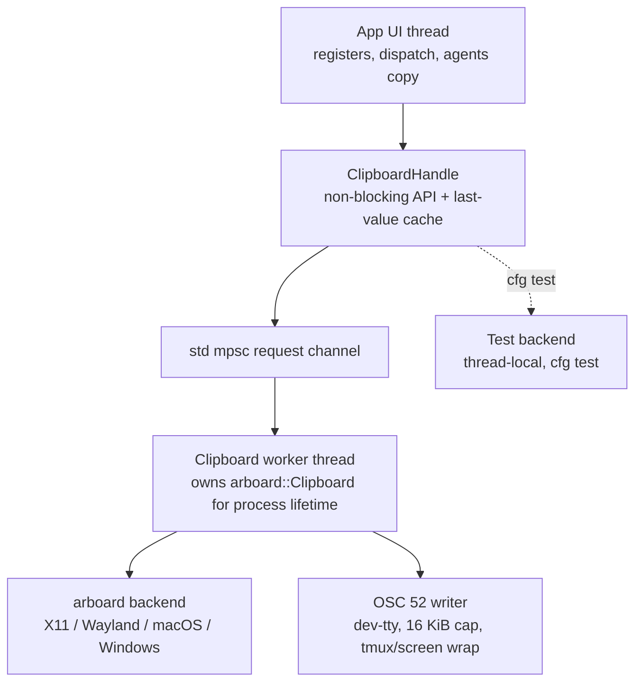

# System Clipboard Integration — Design + Plan

Status: **design, decisions locked; phases 1–3 landed** · Ask: make `y`/`d`/`p` reach the OS clipboard like Vim's `clipboard=unnamedplus`, using `arboard` as the primary transport and OSC 52 as the fallback/remote path.

## 1. Current state (verified)

Describes the tree before phase 1 landed; see §1.1 for what phase 1 changed.

System clipboard support exists but is explicit-register only.

| Piece | Location | Status |
| --- | --- | --- |
| `+` / `*` register names | `crates/ee-cli/src/registers.rs:9-27` | done |
| `"` prefix → pending register | `keymap/vim.rs:78` (`RegisterPrefix`), `app/key_sequence.rs:138-157` | done |
| `"+y` writes clipboard | `registers.rs:118-127` (`yank`), `:151-160` (`delete`) | done |
| clipboard read on paste | `registers.rs:98-99` → `read_clipboard` `:202-216` | partial |
| OSC 52 write | `registers.rs:282-295`, writes `/dev/tty` | done, unbounded |
| xclip / xsel shell-out | `registers.rs:213-214`, `:245-248` | X11 only |
| commands `:yank_to_clipboard` etc. | `app/commands/execute.rs:156-193`, `commands/mod.rs:503-542` | done |
| actions + dispatch | `app/dispatch.rs:440-451`, `:633-648` | done |
| keymap hints `+` / `*` | `keymap/hints.rs:152-161` | done |
| agents `/copy` → system clipboard | `registers.rs:257-261` + `app/agent_pane/app_workflow.rs:543` | done, `#[cfg(feature = "agents")]` |

Gaps:

- Plain `y`/`d` never reach the OS clipboard: `take_register` falls back to `Unnamed` (`app/registers.rs:56-58`), and `RegisterStore::yank`/`delete` only touch the OS when the target is `Clipboard`/`PrimaryClipboard`.
- No config option: `EeToml` (`config/raw.rs:30-77`) and `EditorSettings` (`config/editor_settings.rs:75-122`) have no clipboard key; `:set clipboard=…` hits the unknown-option arm (`app/commands/settings.rs:148-161`).
- No Wayland backend, no macOS/Windows backend. No `WAYLAND_DISPLAY` handling anywhere.
- OSC 52 has no size cap; large yanks are silently dropped by terminals/tmux.
- Write path spawns `xclip`/`xsel` and calls `child.wait()` on the UI thread (`registers.rs:235-248`).
- Failures are discarded (`registers.rs:119`, `:152`) — no user feedback.
- Uppercase register append is dropped: `app/key_sequence.rs:150-154` computes `append` then `let _ = append;`.
- Hand-rolled base64 in `registers.rs:298-320` while the `base64` crate is already a dependency (`crates/ee-cli/Cargo.toml`, used at `secrets/vault.rs:31`).

Boundary: `RULE.md:37-38` and `RULE.md:60-61` place clipboard, registers, bracketed paste, and OSC 52 in the frontend (`ee-cli`). This plan changes frontend only. No backend, xi edit protocol, or schema change.

### 1.1 Phase 1 as landed

- `crates/ee-cli/src/clipboard/` holds `mod.rs` (handle, cache, `cfg(test)` switch), `backend.rs` (arboard worker), `osc52.rs` (terminal write), `policy.rs` (`ClipboardSelection`), `test_backend.rs` (thread-local fake).
- `registers.rs` keeps register semantics and delegates `+`/`*` to `ClipboardHandle`; the xclip/xsel shell-out and the hand-rolled base64 encoder are gone (the `base64` crate is used instead).
- The worker thread starts lazily, so test and headless starts spawn nothing; reads wait at most 100 ms and fall back to the last value this process wrote or read.
- OSC 52 still emits inline on the calling thread and for the `+` selection only; ordering by policy and the tmux/screen wrapper are phase 3 work.
- Behaviour of `+`/`*` is unchanged: no config keys, no routing, no status messages yet.

### 1.2 Phase 2 as landed

- `clipboard/policy.rs` adds `ClipboardRouting` (`UnnamedPlus`/`Unnamed`/`Off`, default `UnnamedPlus`) and `ClipboardBackendKind` (`Auto`/`Arboard`/`Osc52`, default `Auto`), with tolerant `parse`/`as_str` and `mirror_selection`.
- `EeToml` gains `clipboard`, `clipboard_backend`, `clipboard_osc52_max_bytes`, `clipboard_wait_on_exit`; `EditorSettings` resolves them with defaults `unnamedplus`/`auto`/`16384`/`true`. A comma list is accepted (`unnamedplus` wins); unknown tokens warn; an empty value means `off`; a value with no known token is ignored (config keeps the current/default routing, `:set` reports `invalid value`).
- `apply_clipboard_env` applies `EE_CLIPBOARD` / `EE_CLIPBOARD_BACKEND` over every file layer; the env lookup is injected so tests stay process-isolated.
- `RegisterStore` holds the routing. `yank`/`delete` mirror the unnamed register to the routed selection **after** the internal update, so numbered-register shifting and the `0` register are preserved. Reads resolve through `RegisterStore::read_register`, which aliases only the unnamed register to the routed selection: a plain `p` uses `default_paste_register`, and an explicit `""` (`""p`, `<C-r>"`) resolves the same way. Any other `"x` prefix wins. Consumers are `App::take_paste_register` (`p`/`P`, `R`-paste, visual `p`) and `insert_register_for_current_mode` (`<C-r>x`).
- `get(Unnamed)` stays internal: routing affects paste resolution and write mirroring, not the getter, so no hidden OS read sneaks into unrelated paths.
- `App::from_path` builds the store from `config.clipboard`; `:set clipboard|cb`, `clipboard_backend`, `clipboard_osc52_max_bytes`, `clipboard_wait_on_exit` all work at runtime and `:set clipboard?` reports the canonical value.
- `schemas/ee-config.schema.json` regenerated for the new keys.
- Not yet: backend policy (`auto`/SSH detection), OSC 52 cap + tmux/screen wrap, error surfacing, `shutdown()`/`wait_on_exit`, agents unification — phase 3.

### 1.3 Phase 3 as landed

- `clipboard/policy.rs` owns the pure decisions: `Transport` (`Arboard`/`Osc52`), `TransportPlan`, `TerminalWrap` (`None`/`Tmux`/`Screen`), `ClipboardConfig` (backend, `osc52_max_bytes`, `wait_on_exit`), `ClipboardEnvironment` (`remote`, `wrap`) detected from `SSH_CONNECTION`/`SSH_TTY`/`SSH_CLIENT` and `TMUX`/`STY`, `write_plan`/`read_transport`, and `classify_write_error`/`classify_read_error` mapping every `arboard::Error` variant onto `FailureAction` (`Retry`/`Fallback`/`Ignore`/`Surface`). Keeping these here rather than inside the `arboard`-only worker is what makes them unit-testable with no display server.
- The worker applies the plan: it tries `primary` then `fallback`, retries once on `ClipboardOccupied`, falls back on `ClipboardNotSupported`/`Unknown`, treats `ContentNotAvailable` as authoritative, and records one status message per failure streak through `ErrorSlot`. The UI thread only sends a channel message; `App::poll_clipboard_status` drains the message into the status bar once per frame.
- `osc52.rs` wraps the sequence for tmux (DCS passthrough, inner `ESC` doubled) and screen, enforces `clipboard_osc52_max_bytes` on raw pre-base64 bytes, and writes to `/dev/tty` only — no stdout fallback, so a headless run cannot corrupt a ratatui frame.
- `ClipboardHandle::shutdown()` sends `Request::Shutdown` and joins the worker; on Linux, when `clipboard_wait_on_exit` is true, the worker re-asserts the last value it placed on the platform clipboard with a bounded `wait_until(now + 2 s)` so a clipboard manager can take ownership. A handle that never spawned a worker returns immediately.
- `:set clipboard_backend|clipboard_osc52_max_bytes|clipboard_wait_on_exit` now reach the handle through `RegisterStore::clipboard()`, so live updates apply without a restart.
- `registers::write_system_clipboard` and its `#[cfg(feature = "agents")]` gate are gone; agents `/copy` uses `App`'s shared handle, so agent-free builds get the same transport.
- Reads were already off the UI thread from phase 1 (bounded `recv_timeout` + cache); phase 3 only made the transport decision dynamic (`read_transport()` returns `None` under a forced `osc52`, so a paste there uses the cache instead of paying a round trip).
- Not yet: docs (README/VIM/CHANGELOG) and the dropped uppercase append — phase 4.

## 2. Goal

```toml
# ~/.ee.toml or ancestor .ee.toml
clipboard = "unnamedplus"              # unset/"" | "unnamed" | "unnamedplus" | "off"
clipboard_backend = "auto"             # auto | arboard | osc52
clipboard_osc52_max_bytes = 16384      # 16 KiB, tmux-safe
clipboard_wait_on_exit = true          # bounded 2 s wait so the OS keeps the last yank
```

- `y`/`d` mirror to the OS clipboard; `p` reads it back when no register is prefixed.
- `arboard` (3.7) is the primary transport: X11, Wayland, macOS, Windows, no shell-out.
- OSC 52 remains the path for SSH, containers, and terminals with no working arboard backend.
- Runtime `:set clipboard=unnamedplus` and `:set clipboard?` work like other options.

## 3. Locked decisions

| # | Decision |
| --- | --- |
| 1 | Default routing is `unnamedplus` (plain `y`/`d` mirror to `+`, plain `p` reads `+`). `unnamed` and `off` are opt-outs. |
| 2 | OSC 52 payload cap default `16384` bytes (raw, pre-base64), tmux-safe; configurable, overflow reported in the status bar. |
| 3 | `wayland-data-control` is enabled unconditionally (no ee cargo feature gate). Validate the musl release target. |
| 4 | On macOS and Windows, `*` maps to the system clipboard (no primary-selection concept there). |
| 5 | `clipboard_wait_on_exit` defaults to `true`: bounded `wait_until(now + 2 s)` so the last yank survives process exit without a clipboard manager. |

## 4. Design

### 4.1 Architecture



A dedicated worker thread owns the single `arboard::Clipboard` because:

- On X11 and Wayland the clipboard content is served by the process that owns the selection. `arboard`'s README requires a long-lived `Clipboard` object or an explicit `wait`; a TUI keeps it alive for the whole session.
- Windows documents that operations should come from one thread.
- `get_text` can block on the owning application, so it must never run on the UI thread.

### 4.2 Module layout

New directory `crates/ee-cli/src/clipboard/`:

| File | Contents |
| --- | --- |
| `mod.rs` | `ClipboardHandle`, `Selection`, request/reply types, last-value cache, error surfacing, `shutdown` |
| `backend.rs` | `SystemBackend`: worker loop, lazy `arboard::Clipboard` creation, retry, selection mapping |
| `osc52.rs` | OSC 52 writer moved out of `registers.rs`: tty handling, `base64` crate, size cap, tmux/screen passthrough |
| `policy.rs` | `ClipboardRouting`, `ClipboardBackendKind`, SSH/tty/env detection, `.ee.toml` + env resolution |
| `test_backend.rs` | `#[cfg(test)]` thread-local fake (moves `TEST_CLIPBOARDS` from `registers.rs:322-346`) |

Register `mod clipboard;` next to `mod registers;` in `crates/ee-cli/src/lib.rs` and `crates/ee-cli/src/main.rs`.

`registers.rs` keeps register semantics only; it loses `read_clipboard`, `write_clipboard`, `clipboard_selection_arg`, `clipboard_xsel_arg`, `write_clipboard_osc52`, and `base64_encode`.

### 4.3 API sketch

```rust
pub(crate) enum Selection { Clipboard, Primary }

pub(crate) struct ClipboardHandle { /* Arc<Inner> */ }

impl ClipboardHandle {
    pub(crate) fn new(settings: ClipboardSettings) -> Self;          // worker starts lazily
    pub(crate) fn write_text(&self, sel: Selection, text: String);   // fire and forget
    pub(crate) fn read_text(&self, sel: Selection) -> Option<String>; // bounded wait, cached fallback
    pub(crate) fn cached(&self, sel: Selection) -> Option<String>;
    pub(crate) fn set_routing(&self, routing: ClipboardRouting);      // live :set update
    pub(crate) fn set_backend(&self, kind: ClipboardBackendKind);
    pub(crate) fn take_error(&self) -> Option<String>;                // status bar, reported once
    pub(crate) fn shutdown(&self);                                    // request stop, join worker
}
```

Reads use `recv_timeout(CLIPBOARD_READ_TIMEOUT_MS)` (100 ms) only for an explicit `"+p`/`"*p`; all other paths read the cache, so the UI never blocks unbounded.

### 4.4 Config surface

`.ee.toml` top-level keys, following the existing flat scalar style in `EeToml`:

| Key | Values | Default |
| --- | --- | --- |
| `clipboard` | `unnamedplus`, `unnamed`, `off`, empty string | `unnamedplus` |
| `clipboard_backend` | `auto`, `arboard`, `osc52` | `auto` |
| `clipboard_osc52_max_bytes` | usize | `16384` |
| `clipboard_wait_on_exit` | bool | `true` |

Tolerant parsing: split `clipboard` on commas (Vim's option is a list); `unnamedplus` wins over `unnamed`; `off` and the empty string both mean `off`. Unknown tokens are reported with a warning but do not abort. A value that names **no** known token is ignored — config keeps the current/default routing and `:set` reports `invalid value` — so a typo cannot silently downgrade `unnamedplus` to `off`.

Env override for tests and headless runs: `EE_CLIPBOARD` (`unnamedplus` | `unnamed` | `off`) and `EE_CLIPBOARD_BACKEND`. Env wins over `.ee.toml`.

Runtime: `:set clipboard=unnamedplus`, `:set clipboard?`, `:set clipboard_backend=osc52`, `:set clipboard_osc52_max_bytes=32768`, `:set clipboard_wait_on_exit=false`, wired into `set_runtime_option`, `runtime_option_value`, and `default_option_value` in `app/commands/settings.rs`.

### 4.5 Register routing

Vim semantics, applied in `RegisterStore::yank` and `RegisterStore::delete`:

| `clipboard` | plain `y` / `d` | plain `p` | `"+` / `"*` |
| --- | --- | --- | --- |
| `unnamedplus` (default) | store internally, mirror to `+` | read `+` | direct |
| `unnamed` | store internally, mirror to `*` | read `*` | direct |
| `off` | store internally | read internal `Unnamed` | status message, no OS call |
| empty / unset (legacy) | store internally | read internal `Unnamed` | direct |

`RegisterName::BlackHole` still discards before any OS call. Explicit `"+y`/`"+p` are unchanged.

Implementation note: the write side mirrors `self.unnamed` at the end of `yank`/`delete` (`mirror_unnamed`), which keeps numbered shifting intact. The read side routes through `RegisterStore::read_register` (unnamed → routed selection), consumed by `App::take_paste_register` and `insert_register_for_current_mode`; `RegisterStore::get(&Unnamed)` itself remains internal-only.

Mapping notes:

- `Selection::Primary` maps to `arboard::LinuxClipboardKind::Primary` on Linux and to the system clipboard on macOS/Windows (decision 4).
- `Selection::Clipboard` maps to `LinuxClipboardKind::Clipboard`, or the platform default clipboard elsewhere.
- `RegisterStore` holds a `ClipboardHandle` so routing lives with register semantics; `App` owns the same handle (`Arc` shared, `app/state.rs:279-283`).

### 4.6 Backend policy

`auto`:

1. `SSH_CONNECTION` / `SSH_TTY` / `SSH_CLIENT` set → OSC 52 first (the remote X11/Wayland clipboard is not the user's laptop), arboard fallback.
2. Otherwise arboard first; on `ClipboardNotSupported` / `Unknown` fall back to OSC 52.

`arboard` and `osc52` force one transport.

Failure mapping:

| `arboard::Error` | Handling |
| --- | --- |
| `ClipboardOccupied` | retry once after a short delay, then surface once |
| `ClipboardNotSupported` | fall back to OSC 52 in `auto`; otherwise surface |
| `ContentNotAvailable` | empty read, no message |
| `ConversionFailure` / `Unknown` | surface once |

Behaviour matrix:

| Situation | `auto` result |
| --- | --- |
| Local X11 | arboard X11 |
| Local Wayland with data-control | arboard Wayland |
| Wayland without data-control | arboard X11 via XWayland, else OSC 52, else surfaced error |
| SSH into remote TUI | OSC 52 (arboard would target the remote display) |
| tmux / screen | arboard, or OSC 52 with passthrough wrap |
| No tty and no backend | surfaced error, `+`/`*` become no-ops with one status message |

### 4.7 OSC 52 hardening

- Escape sequence `ESC ] 52 ; c ; <base64> BEL`, written to `/dev/tty` (fallback: skip, never stdout, so ratatui frames are not corrupted).
- tmux (`TMUX` set): DCS passthrough `ESC P tmux ; ESC ESC ] 52 ; c ; <b64> BEL ESC \`.
- screen (`STY` set): `ESC P ESC ] 52 ; c ; <b64> BEL ESC \`.
- Size cap `clipboard_osc52_max_bytes` measured on raw bytes before base64; over cap → skip and report once.
- Reuse the `base64` crate; delete `base64_encode`.
- Both selections use the `c` selection parameter (most terminals only implement `c`); documented limitation for `*`.

### 4.8 Lifecycle

- Worker starts lazily on the first clipboard request, so unit tests and headless starts spawn no thread.
- `Clipboard::new()` failure is not fatal: retry on the next request, surface after repeated failure.
- `App` shutdown calls `ClipboardHandle::shutdown()`; when `clipboard_wait_on_exit` is true the worker calls `set().clipboard(kind).wait_until(Instant::now() + 2 s)` before dropping the `Clipboard`, so the last yank survives exit when no clipboard manager is running. `shutdown()` is called *after* the terminal is restored, so the bounded wait never freezes the alternate screen.
- `wait()` is never called in a request path: it blocks until the clipboard is overwritten.
- Cost of the exit wait, measured from the `arboard` source: on **Wayland** `wait_until` is effectively ignored — `wl-clipboard-rs` backgrounds the copy (its non-foreground daemon path), so shutdown returns immediately and the clipboard already survives. On **X11** `wait_until` blocks the calling thread for the full window unless another client takes the clipboard (`SelectionClear` is the only early wake), so an X11 exit can pause up to 2 s; the `arboard` clipboard-manager handover on drop adds up to 100 ms. Users who prefer a snappy exit set `clipboard_wait_on_exit = false`, which still performs the handover. Shortening the default window is an open point (§8).

### 4.9 Agents path

`registers::write_system_clipboard` (`registers.rs:257-261`) is replaced by `App`-owned `ClipboardHandle::write_text`; `app/agent_pane/app_workflow.rs:543` updates to the handle and keeps redaction and error reporting. The `#[cfg(feature = "agents")]` special case disappears; agent-free builds get the same transport.

## 5. Plan

### Phase 1 — transport swap, no behaviour change

1. Add the workspace dependency:
   ```toml
   arboard = { version = "3.7", default-features = false, features = ["wayland-data-control"] }
   ```
   plus `arboard.workspace = true` in `crates/ee-cli/Cargo.toml`. Commit `Cargo.lock`. `default-features = false` avoids the `image` crate; `parking_lot`, `percent-encoding`, and `rustix` are already in the lockfile.
2. Create `clipboard/{mod,backend,osc52,policy,test_backend}.rs`; register the module in `lib.rs` and `main.rs`.
3. Move OSC 52 + selection helpers out of `registers.rs`; `registers.rs` delegates to `ClipboardHandle`.
4. Keep the thread-local test seam so tests never touch a real clipboard.
5. No config, no routing change: `+`/`*` behave exactly as today.

Validation: `cargo test --quiet -p ee-cli`, `cargo clippy --workspace --all-targets --all-features --locked -- -D warnings`, `cargo build --locked --release --target x86_64-unknown-linux-musl -p ee-cli`.

### Phase 2 — Vim routing and config (landed)

1. `ClipboardRouting` / `ClipboardBackendKind` in `clipboard/policy.rs`.
2. `EeToml` keys (`config/raw.rs`), `EditorSettings` fields + `Default` + `merge_toml` (`config/editor_settings.rs`), env overrides.
3. Routing in `RegisterStore::yank` / `delete` and the paste fallback in `take_register`.
4. `:set` support in `app/commands/settings.rs` for all four options.
5. `App::from_path` constructs the handle from resolved settings (`app/state.rs`).
6. Status message when a yank reaches the OS clipboard is not added; only failures surface (phase 3).

Deltas from the sketch: the paste fallback is `App::take_paste_register` (yank/delete keep `take_register` returning `Unnamed`, so the numbered shift is not skipped); `get(&Unnamed)` stays internal; `config/init.rs` renders the new keys into the merged config document and the JSON schema was regenerated.

### Phase 3 — backend policy, OSC 52 hardening, agent unification (landed)

1. SSH/tty detection and the `auto` chain.
2. OSC 52 size cap, tmux/screen wrap, tty-only write.
3. Error surfacing (once per failure streak), `ClipboardOccupied` retry.
4. `ClipboardHandle::shutdown()` + `clipboard_wait_on_exit` handling.
5. Agent `/copy` and `registers::write_system_clipboard` call sites move to the handle.

Deltas from the sketch: the transport policy lives on the worker, not the UI thread — `write_text` is a channel send and the worker resolves `primary`/`fallback` itself, so a failed arboard write can fall back to OSC 52 without the UI thread ever waiting on a display server. `ContentNotAvailable` on a write maps to `Ignore` (nothing to report); `Unknown` maps to `Fallback` in `auto` and surfaces otherwise. OSC 52 over-cap skips and reports rather than falling back, because the fallback would target the wrong clipboard over SSH. On shutdown the worker re-asserts the last value *it* placed on the platform clipboard (it remembers the successful arboard write) rather than the handle re-sending a cached value.

### Phase 4 — docs and polish (landed)

1. `README.md` clipboard config block; `VIM.md` clipboard row (the `space`/`K` conflict table gains a note that routing does not affect those keys); `CHANGELOG.md` entry for the default change. Landed.
2. Prefetch: evaluated and deferred. A tick prefetch polls the OS clipboard on every interval forever (an X11 round-trip to the owning application, a Wayland `data-control` transfer each time) and `read_text`'s cold path is a *timeout*, not a sleep, so a healthy read already returns in milliseconds — the win is marginal and the cost is continuous. The polite trigger is terminal focus-gain, which needs crossterm focus reporting that ee does not currently enable; revisit only if a focus hook lands.
3. Fixed the dropped uppercase append (`app/key_sequence.rs`): `InputState::pending_register_append` records the uppercase designator, `App::take_register` returns `(RegisterName, bool)`, and all 20 yank/delete call sites pass the flag into `RegisterStore::yank`/`delete`; `take_paste_register` clears it. Landed.

### Phase 5 — validation and compatibility matrix (landed)

1. Unit + E2E coverage as in the test plan below; new E2E tests in `tests/edit_paste.rs` for default mirroring, a changed external clipboard on `p`, and explicit `+` under `off`.
2. `cargo test --quiet --workspace --all-features --locked` and clippy `-D warnings` pass; `cargo tree -d` shows arboard adds no new duplicate version and no `image`.
3. Recorded as untested locally: the musl (`x86_64-unknown-linux-musl`) and macOS release builds, and the live platform matrix (X11, Wayland with/without data-control, tmux, SSH, macOS).

## 6. Test plan

| Layer | Test |
| --- | --- |
| Unit | routing matrix `unnamedplus` / `unnamed` / `off` / empty; `+` and `*` stay distinct; `BlackHole` and `Named` unaffected |
| Unit | test backend write → read roundtrip; per-test isolation (thread-local, no `static mut`) |
| Unit | OSC 52 encoder golden bytes; tmux wrapper; screen wrapper; over-cap skip; no-tty skip |
| Unit | selection mapping: `+`→`Clipboard`, `*`→`Primary` on Linux, `*`→`Clipboard` elsewhere |
| Unit | config parse, comma list, unknown token warning, layer precedence, env override |
| Unit | `:set clipboard?`, each option value, invalid value message |
| E2E | existing `tests/edit_paste.rs` stays green; `unnamedplus` mirrors on `y`/`d`; explicit `"+y` unchanged; `p` reads a changed clipboard |
| E2E | `default_routing_mirrors_plain_yank_to_system_clipboard`; `plain_paste_reads_a_changed_system_clipboard`; `off_routing_keeps_plain_yank_internal_but_explicit_register_works` |
| Build | `cargo test --quiet --workspace --all-features --locked`, clippy `-D warnings`, musl and macOS targets |
| Manual | X11, Wayland with and without data-control, tmux, SSH, macOS |

Constraints: no test spawns `xclip`, `xsel`, `wl-copy`, or a real `arboard::Clipboard`; the fake backend is the only seam. Path assertions follow the macOS canonicalization rule in `AGENTS.md`.

Phase-2 coverage landed: `clipboard/policy.rs` (routing + backend parse matrix, `mirror_selection`), `registers.rs` (mirror on plain/named yank and delete, numbered shift preserved, `default_paste_register` per routing, `set_routing`), `config/tests/editor.rs` (defaults, per-key parse, comma list, empty→off, env precedence/unknown), and `tests/edit_commands.rs` (`:set` each option, `:set clipboard?`, invalid value).

## 7. Risks

| Risk | Mitigation |
| --- | --- |
| Linux clipboard content disappears on exit | Worker holds `Clipboard` for the process lifetime; `clipboard_wait_on_exit` bounded wait plus the `arboard` clipboard-manager handover on drop |
| X11 exit pauses for the full `clipboard_wait_on_exit` window | Bounded at 2 s and applied only when a platform write succeeded; runs after the terminal is restored; `clipboard_wait_on_exit = false` opts out |
| `Clipboard::new()` fails headless | Lazy create, retry, no panic, OSC 52 fallback |
| Wayland compositor lacks data-control | arboard falls back to X11; otherwise OSC 52 |
| `get_text` blocks on a hung owner | Worker thread + 100 ms bounded read + cache |
| `wait()` blocks until overwritten | Only `wait_until` on shutdown, never in a request path |
| OSC 52 too large or unsupported | 16 KiB cap + status message; arboard is primary |
| tmux intercepts OSC 52 | DCS passthrough wrapper when `TMUX` is set |
| Default `unnamedplus` changes behaviour for existing users | Intentional; documented in `CHANGELOG.md`, `off`/`unnamed` opt-outs |
| musl release build with `wayland-data-control` | Validate the musl target in Phase 1; fall back to an ee cargo feature only if it fails |
| New dependency tree | `default-features = false` drops `image`; run `cargo tree -d` and audit the new crates |
| Test threads leaking | Test backend is used under `cfg(test)`; worker starts lazily |

## 8. Open points

- Exact `recv_timeout` value for explicit `"+p` (100 ms proposed) if Wayland round-trips prove slower.
- Whether `unnamedplus` should also mirror the unnamed register on `x`/`X`/`r` (Vim mirrors, this plan mirrors all `yank`/`delete` paths, which covers them).
- Whether to expose `clipboard_backend` in the command palette as a toggle; not required by the ask.
- OSC 52 volume: under the default `unnamedplus`, every plain `y`/`d` mirrors, so every delete emits an OSC 52 write to `/dev/tty` (phase 1 always emits for the `+` selection). Terminals that rate-limit OSC 52, or users who want arboard only, need the `clipboard_backend` gate from phase 3; consider suppressing OSC 52 for short/linewise deletes if it proves noisy.
  - Resolved in phase 3: under `auto` locally, `arboard` is primary and OSC 52 is emitted only when `arboard` fails, so a normal local yank sends no OSC 52 at all. OSC 52 is emitted for every write only under a forced `clipboard_backend = "osc52"` or over SSH.
- Exit-wait window: should the default `clipboard_wait_on_exit` window stay at 2 s, or shrink (e.g. 250 ms) now that the `arboard` handover on drop is what actually saves the selection on X11?
- Prefetch (phase 4, deferred): a tick/focus prefetch would poll the OS clipboard forever to save a cold read that is already a bounded *timeout* rather than a sleep, so a healthy read returns in milliseconds. Prefetching on terminal focus-gain is the polite trigger but needs crossterm focus reporting, which ee does not enable. Revisit only if a focus hook lands or Wayland round-trips prove slow enough to matter.

## 9. Exit criteria

- [x] `y`, `d`, `Y`, operators, and visual yanks reach the OS clipboard under the default `unnamedplus`; `p` reads it back.
- [x] `+` and `*` still work explicitly, including `*` on macOS/Windows.
- [x] `:set clipboard=…`, `:set clipboard?`, and the other three options work at runtime.
- [x] OSC 52 uses the tmux/screen wrapper, respects the 16 KiB cap, never writes to stdout when no tty exists.
- [x] No clipboard work runs on the UI thread: register writes are channel sends, reads are bounded with a cache fallback.
- [x] Clipboard failures produce one actionable status message; no silent no-ops.
- [x] Agents `/copy` uses the same transport with no `cfg(feature = "agents")` special case.
- [x] `cargo test --quiet --workspace --all-features --locked` and clippy `-D warnings` pass; `cargo tree -d` clean of new duplicates. musl and macOS builds and the live platform matrix recorded as untested locally (no target/toolchain or display server).
